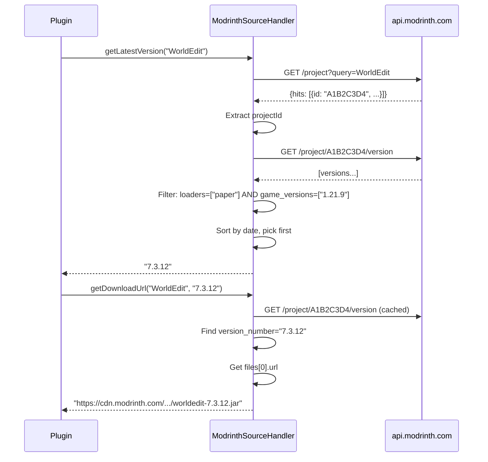
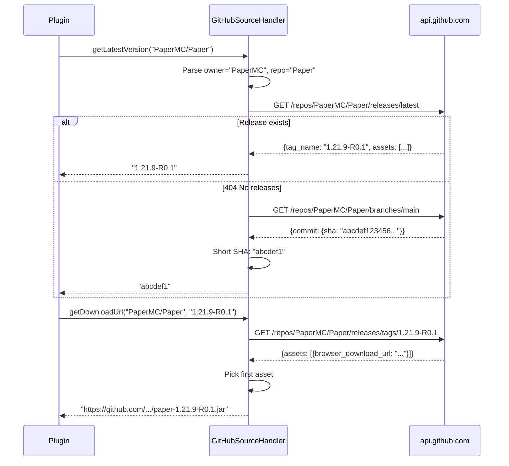
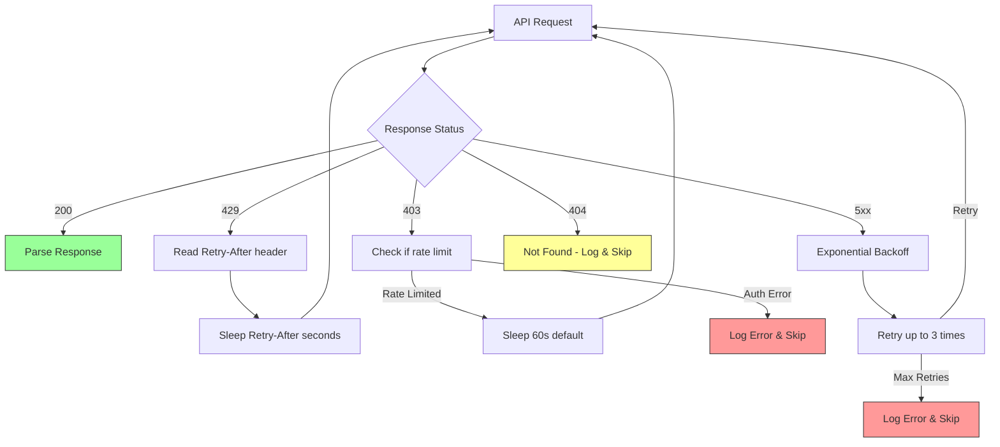
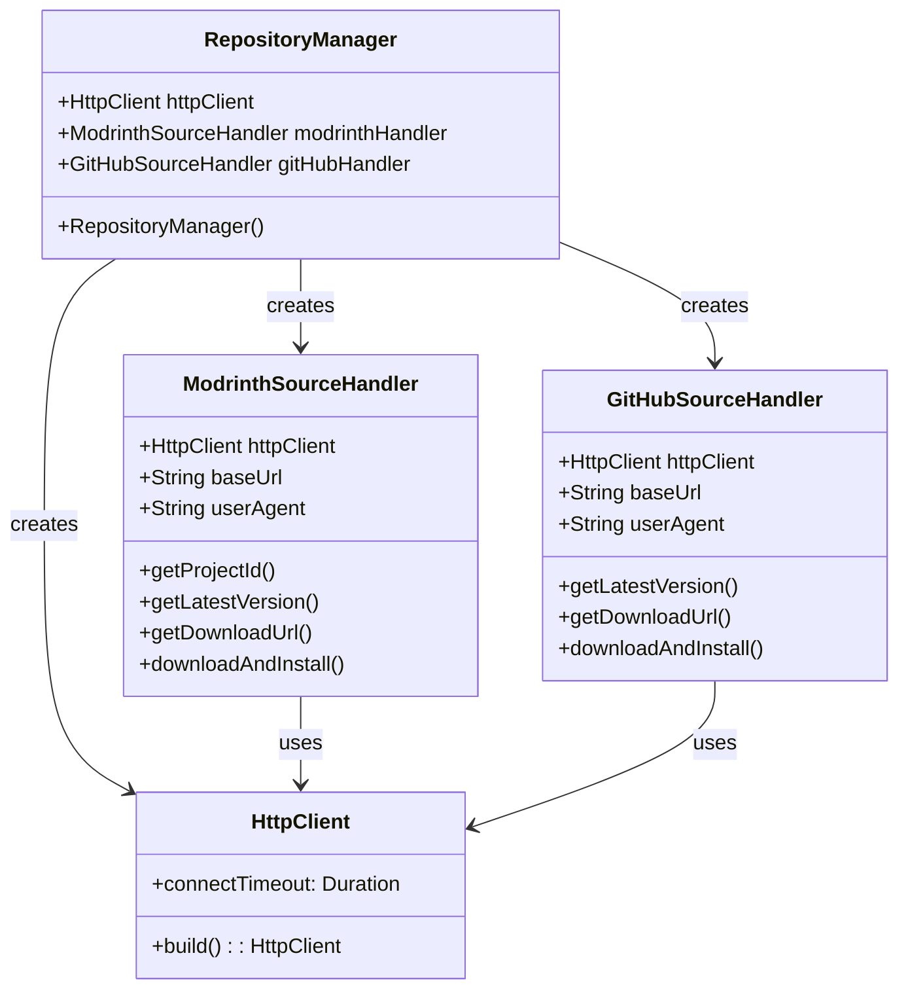

# API Integration Documentation

## Overview

The plugin integrates with two external APIs for plugin discovery and downloads:

1. **Modrinth API v2** - Primary source for Paper/Spigot plugins
2. **GitHub Releases API** - Secondary source for plugins hosted on GitHub

All network requests run asynchronously on background threads.

## Modrinth API

### Base URL
```
https://api.modrinth.com/v2
```

### Required Headers
```
User-Agent: HanafubukiPluginUpdater/<version>
Accept: application/json
```

### Modrinth API Flow



### Endpoints Used

#### 1. Search Project
```
GET /project?query={pluginName}
```

**Response** (simplified):
```json
{
  "hits": [
    {
      "id": "A1B2C3D4",
      "slug": "worldedit",
      "title": "WorldEdit",
      "project_type": "plugin",
      "loaders": ["paper", "spigot", "bukkit"],
      "game_versions": ["1.21.9", "1.21.8"]
    }
  ]
}
```

**Used by**: `ModrinthSourceHandler.getProjectId()`

#### 2. Get Project Versions
```
GET /project/{projectId}/version
```

**Response** (simplified):
```json
[
  {
    "version_number": "7.3.12",
    "name": "WorldEdit 7.3.12",
    "loaders": ["paper", "spigot"],
    "game_versions": ["1.21.9", "1.21.8"],
    "files": [
      {
        "url": "https://cdn.modrinth.com/data/.../worldedit-7.3.12.jar",
        "filename": "worldedit-7.3.12.jar",
        "primary": true,
        "size": 1234567,
        "hashes": {
          "sha1": "...",
          "sha512": "..."
        }
      }
    ],
    "version_type": "release",
    "status": "listed"
  }
]
```

**Used by**: `ModrinthSourceHandler.getLatestVersion()`, `getDownloadUrl()`

### Version Filtering Logic

The plugin filters versions client-side after fetching all versions:

```java
// Required filters (hardcoded for Paper 1.21.9)
loaders.contains("paper") && gameVersions.contains("1.21.9")
```

**Configurable via** `modrinth.loaders` and `modrinth.game_versions` (not yet implemented in code).

### Rate Limits

- **Unauthenticated**: 300 requests/hour per IP
- **Authenticated**: Higher limits with token
- **Recommendation**: Cache project IDs to avoid repeated searches

### Error Handling

| Status | Meaning | Action |
|--------|---------|--------|
| 200 | Success | Parse response |
| 404 | Not found | Plugin not on Modrinth |
| 429 | Rate limited | Wait and retry |
| 5xx | Server error | Log and skip |

## GitHub API

### Base URL
```
https://api.github.com
```

### Required Headers
```
User-Agent: HanafubukiPluginUpdater/<version>
Accept: application/vnd.github+json
Authorization: Bearer <token> (optional)
```

### GitHub API Flow



### Endpoints Used

#### 1. Get Latest Release
```
GET /repos/{owner}/{repo}/releases/latest
```

**Response** (simplified):
```json
{
  "tag_name": "1.21.9-R0.1",
  "name": "Paper 1.21.9-R0.1",
  "assets": [
    {
      "name": "paper-1.21.9-R0.1.jar",
      "browser_download_url": "https://github.com/.../paper-1.21.9-R0.1.jar",
      "size": 50000000
    }
  ],
  "prerelease": false,
  "draft": false
}
```

**Used by**: `GitHubSourceHandler.getLatestVersion()`, `getDownloadUrl()`

#### 2. Get Release by Tag
```
GET /repos/{owner}/{repo}/releases/tags/{tag}
```

**Used by**: `GitHubSourceHandler.getDownloadUrl()` for specific version

#### 3. Get Branch (fallback)
```
GET /repos/{owner}/{repo}/branches/main
```

**Response**:
```json
{
  "commit": {
    "sha": "abcdef123456...",
    "url": "https://api.github.com/repos/.../commits/abcdef123456"
  }
}
```

**Used by**: `GitHubSourceHandler.getLatestVersion()` when no releases exist

### Repository Format

GitHub plugins must use `owner/repo` format in config:
```yaml
plugins:
  "Paper":
    source: "github"
    version: "1.21.9-R0.1"
    repo: "PaperMC/Paper"
```

### Rate Limits

| Auth | Limit |
|------|-------|
| Unauthenticated | 60 requests/hour per IP |
| Authenticated (token) | 5000 requests/hour per user |

**Recommendation**: Add `github.token` in config for production use.

### Error Handling

| Status | Meaning | Action |
|--------|---------|--------|
| 200 | Success | Parse response |
| 404 | Not found | No releases/branch |
| 403 | Rate limited / forbidden | Check token, wait |
| 5xx | Server error | Log and skip |

## User-Agent Requirements

Both APIs **require** a unique User-Agent header. The plugin uses:

```
HanafubukiPluginUpdater/<version>
```

Where `<version>` comes from `gradle.properties` (expanded at build time).

**Modrinth policy**: Requests without User-Agent are rejected (403).
**GitHub policy**: Requests without User-Agent are rejected (403).

## Implementation Details

### ModrinthSourceHandler Methods

```java
// Search for project ID by name
String getProjectId(String pluginName) throws IOException

// Get latest compatible version
String getLatestVersion(String pluginName) throws IOException

// Get download URL for specific version
String getDownloadUrl(String pluginName, String version) throws IOException

// Download and install (placeholder)
void downloadAndInstall(String pluginName, String downloadUrl) throws IOException
```

### GitHubSourceHandler Methods

```java
// Get latest release tag or commit SHA
String getLatestVersion(String pluginName) throws IOException

// Get download URL for specific version
String getDownloadUrl(String pluginName, String version) throws IOException

// Download and install (placeholder)
void downloadAndInstall(String pluginName, String downloadUrl) throws IOException
```

### Shared HTTP Client

Both handlers share a single `HttpClient` instance from `RepositoryManager`:

```java
HttpClient.newBuilder()
    .connectTimeout(Duration.ofSeconds(10))
    .build()
```

Timeout configurable via config (not yet implemented).

### Rate Limit Handling Strategy



### HTTP Client Configuration



## Adding a New Source

To add a new source (e.g., SpigotMC, Hangar):

1. Create `NewSourceHandler` in `com.hanafubuki.updater.source`
2. Implement methods: `getLatestVersion()`, `getDownloadUrl()`, `downloadAndInstall()`
3. Register in `RepositoryManager` constructor
4. Add routing logic in `PluginUpdater.updateSinglePlugin()`
5. Add config section in `ConfigManager`

## Testing API Integration

### Modrinth Test
```bash
# Search WorldEdit
curl -H "User-Agent: Test/1.0" "https://api.modrinth.com/v2/project?query=worldedit"

# Get versions
curl -H "User-Agent: Test/1.0" "https://api.modrinth.com/v2/project/A1B2C3D4/version"
```

### GitHub Test
```bash
# Latest release
curl -H "User-Agent: Test/1.0" "https://api.github.com/repos/PaperMC/Paper/releases/latest"

# With token
curl -H "User-Agent: Test/1.0" -H "Authorization: Bearer ghp_xxx" "https://api.github.com/repos/PaperMC/Paper/releases/latest"
```

## Security Considerations

1. **No secrets in code**: GitHub token only in config.yml (not committed)
2. **HTTPS only**: All API endpoints use HTTPS
3. **Input validation**: Plugin names sanitized before API calls
4. **Download verification**: File name validated against expected plugin name
5. **No arbitrary code execution**: Only JAR downloads to update folder