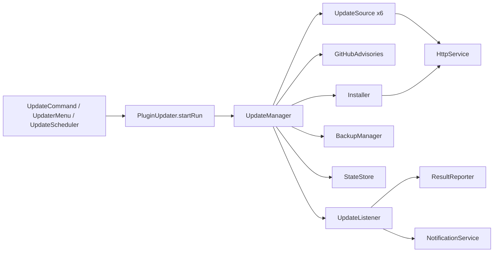
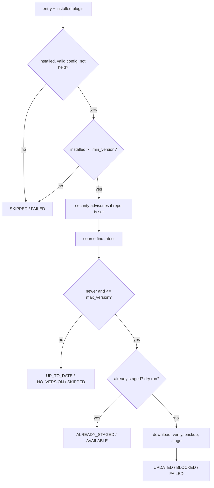
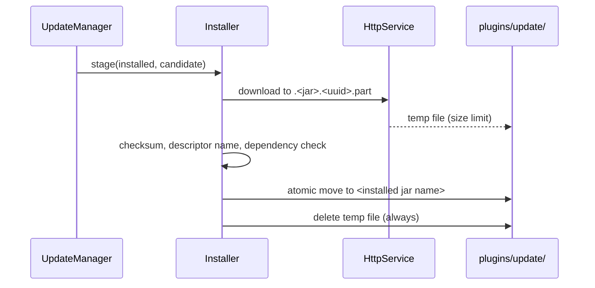

# Architecture

Hanafubuki Plugin Updater is a Paper plugin (`com.hanafubuki.updater.PluginUpdater`, extends `JavaPlugin`).
It finds newer versions of the server's plugins, downloads and verifies them in the background and stages
them in the Bukkit update folder. Paper swaps them in on the next restart. Running jars are never touched.

## Packages

The code is split into a **core** that does not use the Bukkit API (unit tested without a server) and a thin
**Paper layer** that connects it to the server.

| Package | Layer | Contents |
|---|---|---|
| `com.hanafubuki.updater` | Paper | `PluginUpdater` (lifecycle, wiring, `startRun`, `reload`, `discover`), `UpdateScheduler`, `JoinListener`, `ServerPlugins` (snapshot of loaded plugins, update folder, Minecraft version), `Permissions` |
| `command` | Paper | `UpdateCommand`: `/updateplugins` sub-commands and tab completion |
| `gui` | Paper | `UpdaterMenu` (inventory menu), `MenuListener` (makes menus read-only, forwards clicks) |
| `console` | Paper | `Messages` (MiniMessage styles), `ResultReporter` (console lines or JSON, in-game messages, writes versions to config.yml) |
| `config` | core + Paper | `SettingsParser` → `UpdaterSettings`, `PluginEntry` (core); `ConfigManager` (Bukkit YAML loading and saving) |
| `manager` | core | `UpdateManager` (the engine), `Installer`, `BackupManager`, `StateStore`, `DependencyChecker`, `Schedule`, `Metrics`, `RunOptions`, `PluginResult`, `UpdateReport`, `UpdateListener` |
| `source` | core | `UpdateSource` interface and `ModrinthSource`, `GitHubSource`, `HangarSource`, `SpigotSource`, `LocalSource`, `CustomHttpSource`; `GitHubAdvisories`; records `UpdateRequest`, `UpdateCandidate`, `InstalledPlugin`, `SourceSettings` |
| `http` | core | `HttpService` (the only HTTP client), `HttpCache`, `RetryPolicy`, `HttpStatusException` |
| `notify` | core | `NotificationService` (Discord and generic webhook) |
| `discovery` | core | `PluginDiscovery` (suggests entries for unconfigured plugins) |
| `health` | core | `HealthServer` (`/health`, `/metrics`) |
| `util` | core | `VersionUtils`, `Checksum`, `PluginDescriptor`, `Glob`, `Json`, `JsonPath` |

The jar bundles no libraries: Gson, SnakeYAML and Adventure/MiniMessage are provided by Paper at runtime.



## Lifecycle

`onEnable`:

1. `ConfigManager.load()` (creates config.yml on first start).
2. Builds the shared `HttpService` (User-Agent `ByteMe6/hanafubuki-plugin-updater/<version>`, in-memory
   cache of 512 responses), `StateStore` (`state.json`), `BackupManager` (`backups/`), `ResultReporter`,
   `UpdateScheduler`.
3. `buildServices()`: one instance of every source, `GitHubAdvisories`, `NotificationService` and the
   `UpdateManager`.
4. Registers `/updateplugins`, `MenuListener`, `JoinListener`; starts the health endpoint (if enabled) and the
   schedule; runs discovery one tick later if `auto_discover_on_startup` is set.

`reload()` (refused while a run is active) re-reads the config and repeats steps 3–4 except the listeners.
Counters in `Metrics` are carried over.

`onDisable`: stops the schedule, cancels the active run and waits up to 5 s, stops the health endpoint, lets
queued notifications finish (up to 5 s), stops the background thread.

## Threads

| Thread | Work |
|---|---|
| Server main thread | Commands, GUI, scheduler ticks. Takes the snapshot of loaded plugins (`ServerPlugins.snapshot()`), sends messages. No network or file I/O. |
| `HanafubukiUpdater-run` | Coordinator of one run (`UpdateManager.execute`). |
| `HanafubukiUpdater-worker-N` | Pool of `global.parallelism` threads; one plugin check each. |
| `HanafubukiUpdater-background` | Backups listing, rollback, unstage, discovery lookups. |
| `HanafubukiUpdater-notify` | Discord / webhook POSTs. |
| `HanafubukiUpdater-health` | Health endpoint requests. |

Results reach Bukkit only through `PluginUpdater.runSync` / `Bukkit.getScheduler().runTask`. All threads are
daemon threads.

## An update run

`PluginUpdater.startRun(RunOptions, requester)` is called on the main thread by a command, the GUI or the
scheduler. It passes `UpdateManager.start()` an immutable snapshot of the loaded plugins, the update folder
(`Bukkit.getUpdateFolderFile()`) and the Minecraft version.

- **One run at a time.** `start` returns empty while a run is active; the caller tells the user.
- **Dry run is part of `RunOptions`**, not shared state, so a check can never turn into an install.
- `RunOptions.only` limits the run to named plugins (see
  [configuration.md](configuration.md#which-plugins-are-checked)).
- Every finished plugin is passed to the `UpdateListener` at once (console line, in-game message) and
  recorded in `state.json`; at the end the `UpdateReport` goes to the listener (summary, notifications).

Steps for one plugin (`UpdateManager.check`):



1. Skip if the plugin is not loaded, the entry fails `UpdateSource.validate()`, or the plugin is held after a
   rollback.
2. Clear the "staged" record if the staged file is gone or the installed version now equals it (the restart
   applied it).
3. Skip if the installed version is below `min_version`.
4. If the entry has a `repo` and `github.advisories` is on, fetch GitHub security advisories for the installed
   version. A failure here only adds a note.
5. `source.findLatest()` returns an `UpdateCandidate` (version, download URL, checksum, download headers,
   freshness, page URL, notes). Empty means `NO_VERSION`.
6. Newer? Sources that know the answer say so (`Freshness.NEWER` / `SAME`, e.g. Modrinth by publish date,
   or identical files); otherwise `VersionUtils.isNewer(candidate, installed)` decides.
7. Skip if the new version is above `max_version`.
8. `ALREADY_STAGED` if the staged file matches the candidate's checksum (or, without a checksum, the version
   recorded in `state.json`). `AVAILABLE` in a dry run.
9. `Installer.stage()` downloads into a temporary file and verifies checksum and plugin name; then the
   dependency check runs and, only if everything passed, the running jar is backed up (if
   `backups.enabled`) right before the new file is moved into the update folder.

### Result statuses

`PluginResult.Status`:

| Status | Meaning |
|---|---|
| `UPDATED` | Downloaded, verified and staged; applied on the next restart. |
| `AVAILABLE` | Dry run: an update exists, nothing was downloaded. |
| `ALREADY_STAGED` | This version is already in the update folder and waits for a restart. |
| `UP_TO_DATE` | The installed version is the newest. |
| `NO_VERSION` | The source has no compatible version (loader, game version, channel, platform). |
| `SKIPPED` | Not checked: not installed, not configured, excluded, below `min_version`, above `max_version`, held after a rollback. |
| `BLOCKED` | An update exists but its dependencies are not met (`dependencies.check: block`). |
| `FAILED` | Error while checking or downloading, or an invalid entry. |
| `CANCELLED` | The run was stopped before this plugin finished. |

### Cancellation

`/updateplugins stop` (or the GUI button) calls `UpdateManager.cancel()`: it marks the run cancelled and
interrupts the worker pool. `HttpService` turns the interrupt into an `InterruptedIOException`, including
during retry waits and inside a download loop, so network calls stop promptly. Unfinished plugins are reported
as `CANCELLED` and are not recorded in the statistics. Temporary files are removed as usual.

## Staging (Installer)



- The target is the update folder from `Bukkit.getUpdateFolderFile()` (default `plugins/update/`, set by
  `settings.update-folder` in bukkit.yml) under **the installed jar's file name**, because that is how Paper
  matches the update to the plugin.
- The download is written to `.<jar name>.<random uuid>.part` in the update folder and deleted in a `finally`
  block, whatever happens.
- Verification before the move: the checksum (if the source has one), a readable `paper-plugin.yml` or
  `plugin.yml` whose `name` equals the installed plugin's name, then the dependency check (`Verifier`).
- The move is atomic (`ATOMIC_MOVE`, plain replace where the file system cannot do that).
- `local` candidates (`file:` URLs) are copied instead of downloaded, with the same size limit.

## State (`state.json`)

`StateStore` keeps `plugins/HanafubukiPluginUpdater/state.json`. Every change is written at once through a
temporary file and an atomic rename. A file that cannot be read is renamed to `state.json.broken` and the
plugin starts with an empty state.

```json
{
  "version": 1,
  "last_run": {
    "trigger": "schedule", "dry_run": false,
    "started": "2026-10-31T01:30:00.012Z", "finished": "2026-10-31T01:30:14.873Z",
    "cancelled": false, "counts": { "UPDATED": 1, "UP_TO_DATE": 9 }
  },
  "plugins": {
    "LuckPerms": {
      "last_check": "2026-10-31T01:30:03.412Z",
      "last_seen_version": "5.5.17",
      "last_result": "UPDATED",
      "staged_version": "5.5.17",
      "staged_at": "2026-10-31T01:30:03.412Z",
      "checks": 42, "updates": 6, "failures": 1,
      "update_history": ["2026-08-02T01:30:05Z", "2026-10-31T01:30:03.412Z"]
    }
  }
}
```

- `last_*` and counters are updated for every finished check (not for cancelled ones). `failures` counts
  `FAILED` results.
- `update_history` keeps the last 50 update times; `/updateplugins stats` shows the average interval between
  them (with at least two updates).
- `staged_version` drives `/updateplugins status`, the on-join reminder and the `ALREADY_STAGED` check.
- `held_version` / `held_at` are set by a rollback (below).

## Backups and rollback

`BackupManager` stores copies in `plugins/HanafubukiPluginUpdater/backups/<Plugin>/<version>__<epochMillis>.jar`.

- Before an update is downloaded, the running jar is copied there (skipped if an identical copy exists).
  Only the newest `backups.keep` copies per plugin are kept.
- `/updateplugins rollback <plugin> [version]` (or a click in the GUI backups view) checks that the backup is
  a valid jar of that plugin and copies it into the update folder under the installed jar's name, replacing
  any staged update. Paper installs it on the next restart. Without a version the newest backup is used.
- After a rollback the plugin is **held**: automatic and manual runs skip it, so the next scheduled run does
  not reinstall the version you rolled back from.
- `/updateplugins unstage <plugin>` deletes the plugin's file from the update folder, clears the staged record
  and releases the hold. Run it **after** the restart to resume updates; before the restart it would also
  remove the staged rollback.

Rollback and unstage are refused while a run is active.

## Scheduler

`UpdateScheduler` turns a `Schedule` into Bukkit tasks: an optional startup run after
`startup_delay_seconds`, then the next run from `Schedule.next(now)` (now + interval, or the next matching
wall-clock time in the configured zone). After each run the next one is planned again. A due run is skipped
when another run is still active. The main-thread task only takes the plugin snapshot; the run itself is
asynchronous. With `check_only: true` scheduled runs are dry runs.

## Discovery

`/updateplugins discover [plugin]` lists loaded plugins that are not in config.yml (the updater itself and
plugins not loaded from a jar are left out). For each, `PluginDiscovery` looks for evidence:

1. The installed jar's SHA-512 on Modrinth (`ModrinthSource.projectIdOf`). Exact: the file itself is
   published there → `source: modrinth, project_id: <id>`.
2. The `website` in the plugin's descriptor:
   `modrinth.com/plugin|mod|project/<slug>` → modrinth, `hangar.papermc.io/<Owner>/<Slug>` → hangar,
   `spigotmc.org/resources/<name>.<id>` → spigotmc, `github.com/<owner>/<repo>` → github. Reserved paths
   (`github.com/sponsors/…`, `hangar.papermc.io/api/…` and similar) are ignored.

Plugins without evidence are only listed ("add it by hand"), never added. `discover add [plugin|all]` writes
the usable suggestions into config.yml (with a comment `added by auto-discovery: <reason>`) and requires
`global.auto_discover: true`; `auto_discover_on_startup: true` does the same once at startup. A GitHub
suggestion has no `asset_pattern`; if the releases contain several jars the first check fails and asks for
one.

## Extending

A new source implements `UpdateSource` (`id`, `validate`, `findLatest`) and is registered in
`PluginUpdater.buildServices()` and `SettingsParser.SOURCES`. See
[development.md](development.md#adding-a-source).
