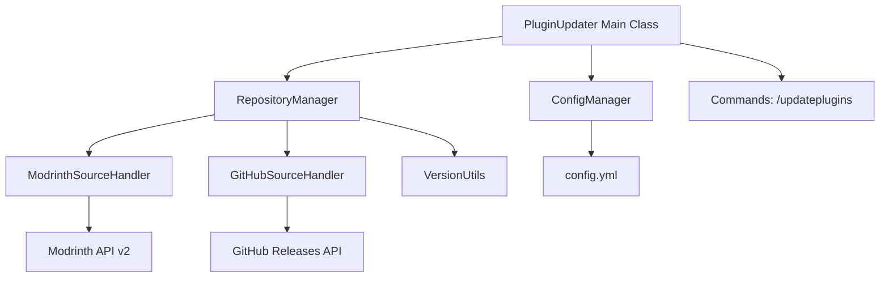
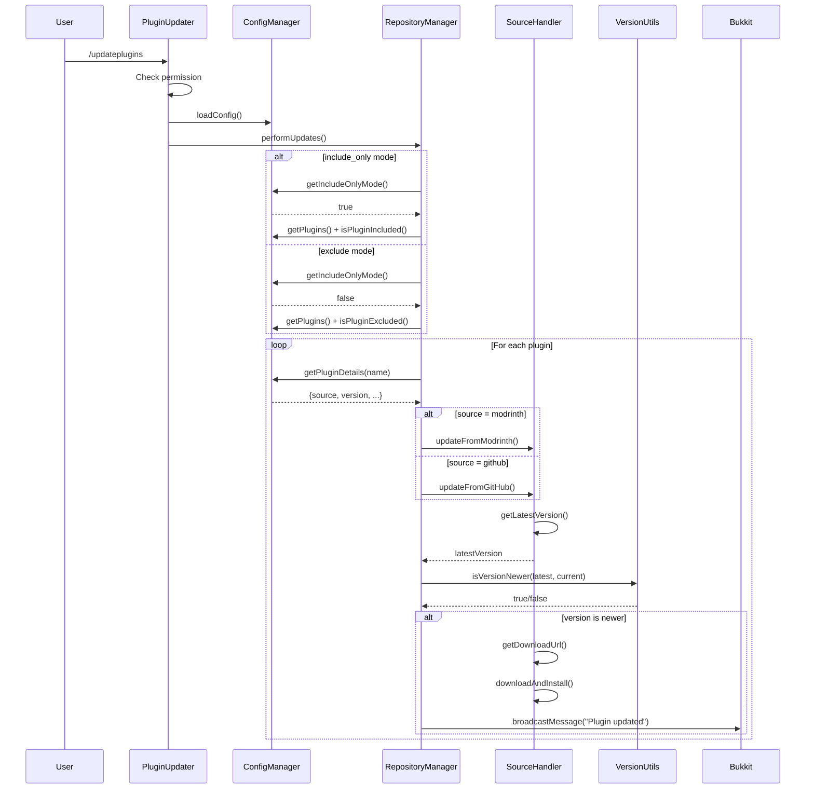
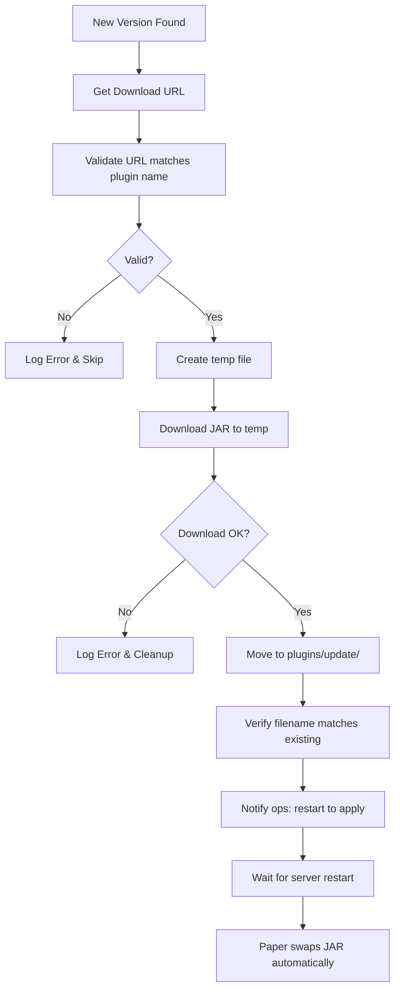

# Architecture Documentation

## Overview

Hanafubuki Plugin Updater is a Paper plugin (Minecraft 1.21.9) that automatically updates other plugins from Modrinth and GitHub sources. The plugin follows a modular architecture with clear separation of concerns.

## System Architecture



## Component Interaction Sequence



## Component Details

### PluginUpdater (Main Class)
- **Package**: `com.hanafubuki.updater`
- **Extends**: `JavaPlugin`
- **Responsibilities**:
  - Plugin lifecycle (onEnable, onDisable)
  - Command registration (`/updateplugins`)
  - Orchestration of update process
  - Permission checking (`hanafubuki.updater.update`)
  - Async execution via `CompletableFuture`

### ConfigManager
- **Package**: `com.hanafubuki.updater.config`
- **Responsibilities**:
  - Load/save YAML configuration
  - Parse global settings, modes, plugin list
  - Provide accessors for:
    - Global version filters (min/max)
    - Update modes (include_only, exclude_list)
    - Plugin details (source, version, project ID)
    - Source-specific configs (Modrinth, GitHub)
    - Console output settings
  - Auto-generates default config from resources

### RepositoryManager
- **Package**: `com.hanafubuki.updater.manager`
- **Responsibilities**:
  - Coordinates updates from multiple sources
  - Manages HTTP client with 10s timeout
  - Delegates to source handlers
  - Notifies ops via broadcast message on successful update
  - Runs all network I/O asynchronously

### ModrinthSourceHandler
- **Package**: `com.hanafubuki.updater.source`
- **API Base**: `https://api.modrinth.com/v2`
- **User-Agent**: `HanafubukiPluginUpdater/<version>`
- **Responsibilities**:
  - Search project by name → get project ID
  - Fetch versions filtered by `loaders=["paper"]` and `game_versions=["1.21.9"]`
  - Get download URL for specific version
  - Download JAR to temp file (placeholder implementation)

### GitHubSourceHandler
- **Package**: `com.hanafubuki.updater.source`
- **API Base**: `https://api.github.com`
- **User-Agent**: `HanafubukiPluginUpdater/<version>`
- **Responsibilities**:
  - Parse `owner/repo` from plugin name
  - Fetch latest release tag
  - Fallback to main branch commit SHA if no releases
  - Get asset download URL from release
  - Download JAR (placeholder implementation)

### VersionUtils
- **Package**: `com.hanafubuki.updater.util`
- **Responsibilities**:
  - Semantic version comparison (major.minor.patch)
  - Handles suffixes (-SNAPSHOT, -beta, etc.)
  - Minimum version checking
  - Special case: "latest" always newer

## Data Flow

```
User runs /updateplugins
        │
        ▼
PluginUpdater.onCommand()
        │
        ▼
CompletableFuture.runAsync(performUpdates)
        │
        ▼
ConfigManager.getIncludeOnlyMode()
        │
        ├── include_only=true ──► updateIncludedPlugins()
        │       │
        │       └── For each plugin in config.plugins:
        │               if isPluginIncluded() → updateSinglePlugin()
        │
        └── include_only=false ──► updateAllExceptExcluded()
                │
                └── For each plugin in config.plugins:
                        if !isPluginExcluded() → updateSinglePlugin()

updateSinglePlugin()
        │
        ▼
ConfigManager.getPluginDetails(pluginName) → {source, version, ...}
        │
        ▼
RepositoryManager.updateFromModrinth() OR updateFromGitHub()
        │
        ▼
SourceHandler.getLatestVersion() → version string
        │
        ▼
VersionUtils.isVersionNewer(latest, current)
        │
        ├─ false ──► Log "up to date"
        │
        └─ true ──► SourceHandler.getDownloadUrl()
                │
                ▼
                SourceHandler.downloadAndInstall()
                │
                ▼
                RepositoryManager.notifyOps() → broadcast to ops
```

## Update Mechanics

### Safe Update Process
1. **Never** overwrite JARs in `plugins/` while server runs
2. Download new JARs to Bukkit update folder: `plugins/update/`
   - Configured via `bukkit.yml → settings.update-folder` (default: `update`)
3. Filename must match existing JAR name
4. Paper swaps JAR on next restart

### Update Process Flow



### Concurrency Model

```mermaid
graph LR
    A[Main Thread] --> B[/updateplugins command]
    B --> C[CompletableFuture.runAsync]
    C --> D[Thread Pool]
    D --> E[Plugin 1: Modrinth API]
    D --> F[Plugin 2: GitHub API]
    D --> G[Plugin 3: Modrinth API]
    D --> H[Plugin N: ...]
    E --> I[Download JAR]
    F --> I
    G --> I
    H --> I
    I --> J[plugins/update/]
    J --> K[Next Restart: Paper swaps]
    
    style A fill:#f9f,stroke:#333
    style C fill:#bbf,stroke:#333
    style D fill:#bfb,stroke:#333
```

## Configuration Structure

```yaml
global:
  min_version: "1.0.0"
  max_version: "99.99.99"

modes:
  include_only: false
  exclude_list: []

modrinth:
  # Modrinth-specific settings

github:
  # GitHub-specific settings

console:
  # Console output styling (MiniMessage)

plugins:
  plugin-name:
    source: "modrinth|github"
    version: "1.0.0"
    # Additional source-specific fields
```

## Error Handling

- Config load failure → plugin disables itself
- API request failure → logged, plugin skipped, others continue
- Version parse failure → treated as equal (no update)
- Download failure → logged, ops not notified

## Extension Points

1. **New Source**: Implement `SourceHandler` interface, register in `RepositoryManager`
2. **Version Strategy**: Extend `VersionUtils` for custom comparison logic
3. **Notification**: Modify `notifyOps()` for Discord/webhook integration
4. **Config Format**: Add new sections to `ConfigManager` accessors