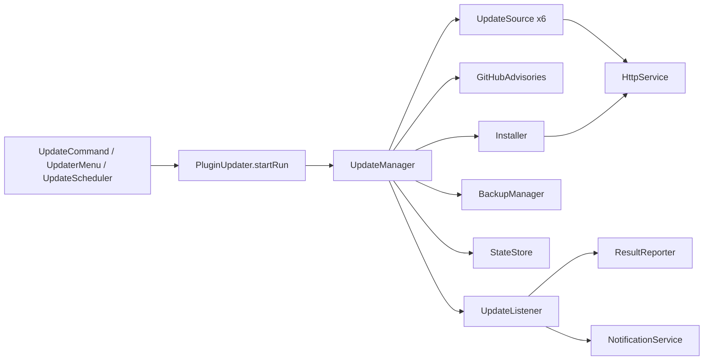
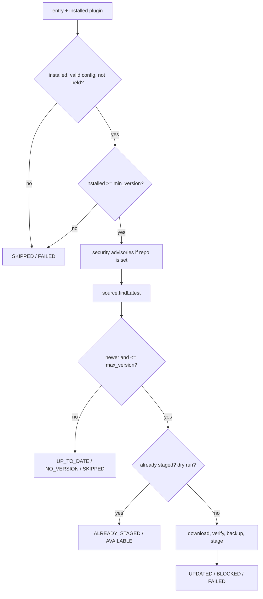
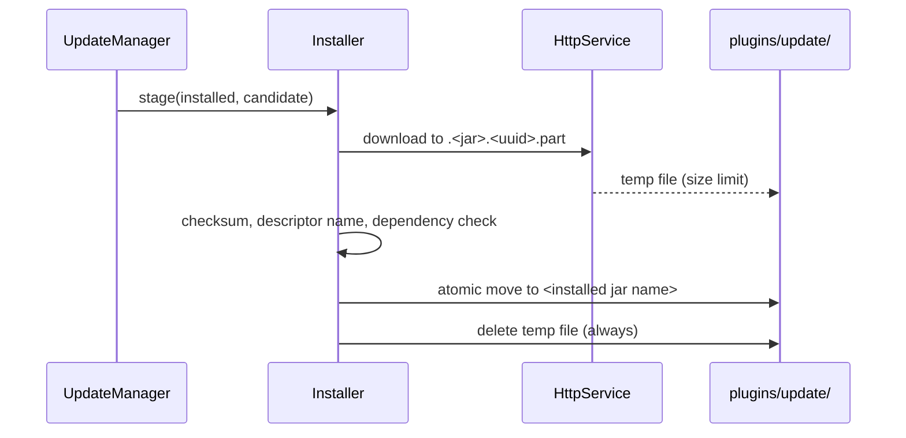

# Architecture

Hanafubuki Plugin Updater is a Paper plugin (`com.hanafubuki.updater.PluginUpdater`, extends `JavaPlugin`).
It finds newer versions of the server's plugins, downloads and verifies them in the background and stages
them in the Bukkit update folder. Paper swaps them in on the next restart. Running jars are never touched.

## Packages

The code is split into a **core** that does not use the Bukkit API (unit tested without a server) and a thin
**Paper layer** that connects it to the server.

| Package | Layer | Contents |
|---|---|---|
| `com.hanafubuki.updater` | Paper | `PluginUpdater` (lifecycle, wiring, `startRun`, `reload`, `detect`, `settings()` = config.yml + confirmed found plugins), `UpdateScheduler`, `JoinListener`, `ServerPlugins` (snapshot of loaded plugins, detection candidates, update folder, Minecraft version), `Permissions` |
| `command` | Paper | `UpdateCommand`: `/updateplugins` sub-commands and tab completion |
| `gui` | Paper | `UpdaterMenu` (inventory menu: plugins, backups, found plugins), `MenuListener` (makes menus read-only, forwards plain mouse clicks one tick later) |
| `console` | Paper | `Messages` (MiniMessage styles), `ResultReporter` (console lines or JSON, in-game messages, detection results) |
| `config` | core + Paper | `SettingsParser` → `UpdaterSettings` (`withDetected` merges confirmed found plugins), `PluginEntry` (core); `ConfigManager` (Bukkit YAML loading, read-only) |
| `manager` | core | `UpdateManager` (the engine), `Installer`, `BackupManager`, `StateStore`, `DependencyChecker`, `Schedule`, `Metrics`, `RunOptions`, `PluginResult`, `UpdateReport`, `UpdateListener` |
| `source` | core | `UpdateSource` interface and `ModrinthSource`, `GitHubSource`, `HangarSource`, `SpigotSource`, `LocalSource`, `CustomHttpSource`; `GitHubAdvisories`; records `UpdateRequest`, `UpdateCandidate`, `InstalledPlugin`, `SourceSettings` |
| `http` | core | `HttpService` (the only HTTP client), `HttpCache`, `RetryPolicy`, `HttpStatusException` |
| `notify` | core | `NotificationService` (Discord and generic webhook) |
| `discovery` | core | `PluginDiscovery` (finds the source of an installed plugin), `PluginRegistry` (`plugins.json`: found plugins and decisions) |
| `health` | core | `HealthServer` (`/health`, `/metrics`) |
| `util` | core | `VersionUtils`, `Checksum` (with a hash cache for installed jars), `PluginDescriptor`, `Glob`, `Json`, `JsonPath`, `AtomicFiles` (temporary file + rename), `Threads` (single threads that exit when idle) |

The jar bundles no libraries: Gson, SnakeYAML and Adventure/MiniMessage are provided by Paper at runtime.



## Lifecycle

`onEnable`:

1. `ConfigManager.load()` (creates config.yml on first start; it is never written afterwards).
2. Builds the shared `HttpService` (User-Agent `ByteMe6/hanafubuki-plugin-updater/<version>`, in-memory
   cache, see [Caches](#caches)), `StateStore` (`state.json`), `PluginRegistry` (`plugins.json`),
   `BackupManager` (`backups/`), `ResultReporter`, `UpdateScheduler`.
3. `buildServices()`: one instance of every source, `GitHubAdvisories`, `NotificationService` and the
   `UpdateManager`.
4. Registers `/updateplugins`, `MenuListener`, `JoinListener`; starts the health endpoint (if enabled) and the
   schedule.
5. One tick later: the staged-update reconciliation (snapshot on the main thread, file checks and the
   `state.json` write in the background) and, with `global.auto_detect`, the automatic
   [detection](#detection-and-pluginsjson).

`reload()` (refused while a run is active) re-reads the config, repeats steps 3–4 except the listeners and,
with `auto_detect` and a valid config, runs the detection. `plugins.json` is not re-read. Counters in
`Metrics` are carried over.

`onDisable`: stops the schedule, cancels the active run and waits up to 5 s, stops the health endpoint, lets
queued notifications finish (up to 5 s), stops the detection thread, shuts down the HTTP client and stops the
background thread (waiting up to 3 s).

## Threads

| Thread | Work |
|---|---|
| Server main thread | Commands, GUI, scheduler ticks. Takes the snapshot of loaded plugins (`ServerPlugins.snapshot()`, `candidates()`), sends messages. No network I/O; the only file write is `plugins.json` on confirm / reject (a few KB). |
| `HanafubukiUpdater-run` | Coordinator of one run (`UpdateManager.execute`). |
| `HanafubukiUpdater-worker-N` | Pool of `global.parallelism` threads; one plugin check each. |
| `HanafubukiUpdater-background` | Backups listing, rollback, unstage, staged-update reconciliation at startup. Exits after 30 s without work and starts again on demand (`Threads.lazySingle`). |
| `HanafubukiUpdater-detect` | Plugin detection and its Modrinth lookups, on its own thread so slow lookups never delay backups, rollback, unstage or the reconciliation. Exits after 30 s without work like the background thread. |
| `HanafubukiUpdater-notify` | Discord / webhook POSTs. Exits after 30 s without work like the background thread. |
| `HanafubukiUpdater-health` | Health endpoint requests. |

Results reach Bukkit only through `PluginUpdater.runSync` / `Bukkit.getScheduler().runTask`. All threads are
daemon threads.

## An update run

`PluginUpdater.startRun(RunOptions, requester)` is called on the main thread by a command, the GUI or the
scheduler. It passes `UpdateManager.start()` the tracked plugins (`PluginUpdater.settings()`: config.yml
entries plus confirmed `plugins.json` entries, config.yml winning on the same name), an immutable snapshot of
the loaded plugins, the update folder (`Bukkit.getUpdateFolderFile()`) and the Minecraft version.

- **One run at a time.** `start` returns empty while a run is active; the caller tells the user.
- **Dry run is part of `RunOptions`**, not shared state, so a check can never turn into an install.
- `RunOptions.only` limits the run to named plugins (see
  [configuration.md](configuration.md#which-plugins-are-checked)).
- Every finished plugin is passed to the `UpdateListener` at once (console line, in-game message) and
  recorded in `state.json`; at the end the `UpdateReport` goes to the listener (summary, notifications).

Steps for one plugin (`UpdateManager.check`):



1. Skip if the plugin is not loaded, the entry fails `UpdateSource.validate()`, or the plugin is held after a
   rollback.
2. Clear the "staged" record if the staged file is gone or the installed version now equals it (the restart
   applied it).
3. Skip if the installed version is below `min_version`.
4. If the entry has a `repo` and `github.advisories` is on, fetch GitHub security advisories for the installed
   version. A failure here only adds a note.
5. `source.findLatest()` returns an `UpdateCandidate` (version, download URL, checksum, download headers,
   freshness, page URL, notes). Empty means `NO_VERSION`.
6. Newer? Sources that know the answer say so (`Freshness.NEWER` / `SAME`, e.g. Modrinth by publish date,
   or identical files); otherwise `VersionUtils.isNewer(candidate, installed)` decides.
7. Skip if the new version is above `max_version`.
8. `ALREADY_STAGED` if the staged file matches the candidate's checksum (or, without a checksum, the version
   recorded in `state.json`). `AVAILABLE` in a dry run.
9. `Installer.stage()` downloads into a temporary file and verifies checksum and plugin name; then the
   dependency check runs and, only if everything passed, the running jar is backed up (if
   `backups.enabled`) right before the new file is moved into the update folder.

### Result statuses

`PluginResult.Status`:

| Status | Meaning |
|---|---|
| `UPDATED` | Downloaded, verified and staged; applied on the next restart. |
| `AVAILABLE` | Dry run: an update exists, nothing was downloaded. |
| `ALREADY_STAGED` | This version is already in the update folder and waits for a restart. |
| `UP_TO_DATE` | The installed version is the newest. |
| `NO_VERSION` | The source has no compatible version (loader, game version, channel, platform). |
| `SKIPPED` | Not checked: not installed, not configured, excluded, below `min_version`, above `max_version`, held after a rollback. |
| `BLOCKED` | An update exists but its dependencies are not met (`dependencies.check: block`). |
| `FAILED` | Error while checking or downloading, or an invalid entry. |
| `CANCELLED` | The run was stopped before this plugin finished. |

### Cancellation

`/updateplugins stop` (or the GUI button) calls `UpdateManager.cancel()`: it marks the run cancelled and
interrupts the worker pool. `HttpService` turns the interrupt into an `InterruptedIOException`, including
during retry waits and inside a download loop, so network calls stop promptly. Unfinished plugins are reported
as `CANCELLED` and are not recorded in the statistics. Temporary files are removed as usual.

## Staging (Installer)

The installed jar comes from `ServerPlugins.jarOf()`. Paper runs Spigot-mapped plugins (GSit, for example)
from a remapped copy in `plugins/.paper-remapped/`; `util/PluginJars.original()` maps that copy back to the
original jar in `plugins/`, which is what gets hashed (Modrinth/Hangar identification) and replaced. A plugin
whose original is not in `plugins/` (added with `-add-plugin`) is not updated.



- The target is the update folder from `Bukkit.getUpdateFolderFile()` (default `plugins/update/`, set by
  `settings.update-folder` in bukkit.yml) under **the installed jar's file name**, because that is how Paper
  matches the update to the plugin.
- The download is written to `.<jar name>.<random uuid>.part` in the update folder and deleted in a `finally`
  block, whatever happens.
- Verification before the move: the checksum (if the source has one), a readable `paper-plugin.yml` or
  `plugin.yml` whose `name` equals the installed plugin's name, then the dependency check (`Verifier`).
- The move is atomic (`ATOMIC_MOVE`, plain replace where the file system cannot do that).
- `local` candidates (`file:` URLs) are copied instead of downloaded, with the same size limit.

## State (`state.json`)

`StateStore` keeps `plugins/HanafubukiPluginUpdater/state.json`. Every change is written at once through a
temporary file and an atomic rename. A file that cannot be read is renamed to `state.json.broken` and the
plugin starts with an empty state.

```json
{
  "version": 1,
  "last_run": {
    "trigger": "schedule", "dry_run": false,
    "started": "2026-10-31T01:30:00.012Z", "finished": "2026-10-31T01:30:14.873Z",
    "cancelled": false, "counts": { "UPDATED": 1, "UP_TO_DATE": 9 }
  },
  "plugins": {
    "LuckPerms": {
      "last_check": "2026-10-31T01:30:03.412Z",
      "last_seen_version": "5.5.17",
      "last_result": "UPDATED",
      "staged_version": "5.5.17",
      "staged_at": "2026-10-31T01:30:03.412Z",
      "checks": 42, "updates": 6, "failures": 1,
      "update_history": ["2026-08-02T01:30:05Z", "2026-10-31T01:30:03.412Z"]
    }
  }
}
```

- `last_*` and counters are updated for every finished check (not for cancelled ones). `failures` counts
  `FAILED` results.
- `update_history` keeps the last 50 update times; `/updateplugins stats` shows the average interval between
  them (with at least two updates).
- `staged_version` drives `/updateplugins status`, the on-join reminder and the `ALREADY_STAGED` check.
- `held_version` / `held_at` are set by a rollback (below).

## Backups and rollback

`BackupManager` stores copies in `plugins/HanafubukiPluginUpdater/backups/<Plugin>/<version>__<epochMillis>.jar`.

- Before an update is downloaded, the running jar is copied there (skipped if an identical copy exists).
  Only the newest `backups.keep` copies per plugin are kept.
- `/updateplugins rollback <plugin> [version]` (the version may contain spaces), or a click in the GUI
  backups view, checks that the backup is a valid jar of that plugin and copies it into the update folder
  under the installed jar's name, replacing any staged update. Paper installs it on the next restart. Without
  a version the newest backup is used; a click in the GUI restores exactly the clicked file, even if several
  backups share a version.
- After a rollback the plugin is **held**: automatic and manual runs skip it, so the next scheduled run does
  not reinstall the version you rolled back from.
- `/updateplugins unstage <plugin>` deletes the plugin's file from the update folder, clears the staged record
  and releases the hold. Run it **after** the restart to resume updates; before the restart it would also
  remove the staged rollback.

Rollback and unstage are refused while a run is active; they check this again when the background task
actually runs.

## Scheduler

`UpdateScheduler` turns a `Schedule` into Bukkit tasks: an optional startup run after
`startup_delay_seconds`, then the next run from `Schedule.next(now)` (now + interval, or the next matching
wall-clock time in the configured zone). After each run the next one is planned again. A due run is skipped
when another run is still active. Before every scheduled run (trigger `schedule`, not the startup run) the
automatic detection is started when `global.auto_detect` is on; plugins it finds wait for confirmation and are
not part of that run. The main-thread task only takes the plugin snapshot; the run itself is asynchronous.
With `check_only: true` scheduled runs are dry runs.

## Detection and `plugins.json`

`PluginUpdater.detect(requester, force)` is started on the main thread: one tick after startup, before every
scheduled run, after `reload()` (all three only with `global.auto_detect`) and by `/updateplugins discover`
(with `force`). Only one detection runs at a time; one requested meanwhile (e.g. by a reload) makes one more
detection run right after the current one finishes (with `auto_detect`). The main thread takes
`ServerPlugins.candidates()` (every loaded plugin from a jar except the updater itself) and the names to skip:
every name under config.yml `plugins:` (`UpdaterSettings.configuredNames()`, including entries with errors)
and `modes.exclude_list`. Everything else runs on the `HanafubukiUpdater-detect` thread.

`PluginRegistry.detect()` keeps the lock off the network:

1. `toLookUp()` (locked): new plugins; `unidentified` ones whose installed version changed or whose last
   lookup failed (`retry`); `pending` ones with `retry`; with `force` every `unidentified` and `pending` one.
   Confirmed and rejected plugins are not looked up again.
2. `PluginDiscovery.discover()` (not locked) looks for evidence per plugin:
   1. The installed jar's SHA-512 on Modrinth (`ModrinthSource.projectIdOf`). Exact: the file itself is
      published there → `source: modrinth, project_id: <id>`.
   2. The `website` in the plugin's descriptor:
      `modrinth.com/plugin|mod|project/<slug>` → modrinth, `hangar.papermc.io/<Owner>/<Slug>` → hangar,
      `spigotmc.org/resources/<name>.<id>` → spigotmc, `github.com/<owner>/<repo>` → github. Reserved paths
      (`github.com/sponsors/…`, `hangar.papermc.io/api/…` and similar) are ignored.

   After the first failed Modrinth lookup the remaining plugins of this detection are not sent to Modrinth
   (circuit breaker); they get the website result and are marked `retry`. A Modrinth failure always sets
   `retry`, also when the website gave a source.
3. `apply()` (locked) stores a plugin with evidence as `pending`, without as `unidentified`. A plugin decided
   meanwhile keeps its decision. A `pending` plugin never loses its source: a later lookup that finds nothing
   only sets `retry`. A retry that finds the exact Modrinth match replaces a website guess and is reported as
   new `pending` again (the source changed); an unchanged result is not reported. Then entries are removed:
   any entry whose name is now skipped (config.yml or `exclude_list`), and every entry except `rejected` ones
   of a plugin that is no longer loaded (a confirmation belongs to the installed plugin; a new jar with the
   same name is reviewed again). The file is written only if something changed.

`ResultReporter.onDetection()` writes the changes to the console (or a `plugins_detected` JSON line), sends
players with `hanafubuki.updater.confirm` a message with a clickable `[review]` when plugins are new
`pending`, and answers the player who ran `discover`.

Decisions (`confirm`, `confirm all`, `reject`, the found plugins view of the GUI) change the registry on the
calling thread and save it at once. `unidentified` plugins cannot be confirmed. GUI actions call the same
command code directly (not `performCommand`), with the same permission checks. Every change raises the
registry's revision; `PluginUpdater.settings()` caches `UpdaterSettings.withDetected(registry.confirmed())`
and rebuilds it only when the revision or the config.yml settings change.

`plugins.json` is written through `AtomicFiles` (temporary file + rename). It is read entry by entry: an entry
that is not an object or has an unknown status is dropped (and looked at again), an option value that is not
a scalar (a list, an object) is dropped, an unknown source is removed (the entry becomes `unidentified` unless
it was rejected). Only a file that cannot be read as a whole (not valid JSON, or not a JSON object) is moved
to `plugins.json.broken`, and the registry then starts empty. The format is in
[configuration.md → Found plugins](configuration.md#found-plugins-pluginsjson).

## Caches

- **HTTP responses** (`HttpCache.inMemory`): LRU of at most 512 responses **and** 4 million characters of
  response text (`DEFAULT_MAX_CHARS`, 4–8 MB of memory: two bytes per character for non-Latin-1 text); a body
  longer than a quarter of that budget is not cached. Used for conditional requests (`ETag` / `Last-Modified`,
  see [api.md](api.md#http-layer)). Lost on restart.
- **Hashes of installed jars** (`Checksum.hashCached`): SHA-512 (Modrinth identification, detection) and
  SHA-256 (Hangar and local identical-file checks) of a jar, keyed by path, size and modification time, at
  most 256 entries. Installed jars only change on a restart, so a check does not re-read large jars every
  time. Downloads are always hashed fresh.
- **Tracked plugins**: `PluginUpdater.settings()`, see above.

## Extending

A new source implements `UpdateSource` (`id`, `validate`, `findLatest`) and is registered in
`PluginUpdater.buildServices()` and `SettingsParser.SOURCES`. See
[development.md](development.md#adding-a-source).
