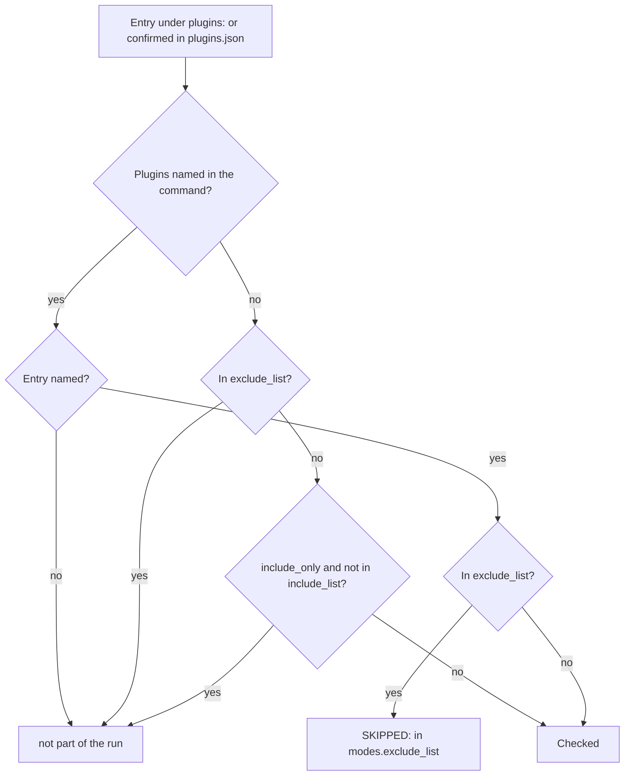
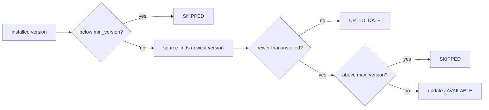

# Configuration reference

The plugin reads `plugins/HanafubukiPluginUpdater/config.yml`. It is created from
[`src/main/resources/config.yml`](../src/main/resources/config.yml) on first start; that file has a
comment on every option. A filled-in configuration that uses every source is in
[`config.example.yml`](config.example.yml) (the test `DefaultConfigTest` makes sure both files parse
without a single problem).

The default config tracks no plugins (`plugins: {}`), so nothing is updated until you add entries or
confirm plugins that automatic detection found (see [Found plugins](#found-plugins-pluginsjson)).

- [How the file is read](#how-the-file-is-read)
- [Secrets from environment variables](#secrets-from-environment-variables)
- [`global`](#global) · [`modes`](#modes) · [`schedule`](#schedule) · [`backups`](#backups) · [`dependencies`](#dependencies)
- [`notifications`](#notifications) (in-game, Discord, generic webhook and its JSON format)
- [Source sections](#source-sections) (`modrinth`, `github`, `hangar`, `spigotmc`, `custom`)
- [`console`](#console) (including the JSON log format) · [`style`](#style) · [`health_check`](#health_check)
- [`plugins`](#plugins) and the options of every source
- [Found plugins (`plugins.json`)](#found-plugins-pluginsjson)
- [Which plugins are checked](#which-plugins-are-checked) · [Version limits](#version-limits) · [Version comparison](#version-comparison)

## How the file is read

`ConfigManager` loads the YAML, `SettingsParser` turns it into an immutable `UpdaterSettings` object.

- **Bad values never disable the plugin.** Every problem is logged as `config.yml: <path>: <problem>`
  and a safe default is used instead. `/updateplugins reload` lists the problems, `/updateplugins status`
  shows how many there are.
- Numbers outside their allowed range are clamped to the nearest limit (and reported).
- Booleans accept `true/false`, `yes/no`, `on/off`.
- YAML 1.1 reads an unquoted `off` as the boolean `false`. Options that take `off` as a word
  (`schedule.mode`, `dependencies.check`, `github.signatures`, per-plugin `signatures`) accept that, so
  `mode: off` and `mode: "off"` mean the same.
- If the file is not valid YAML, the previous settings stay active (on first start: built-in defaults
  with no plugins) and the error is logged.
- Plugin names may contain dots; they are handled as single keys.
- **The file belongs to you.** The plugin creates it on first start and never writes to it afterwards.
  Plugins found automatically go to `plugins.json`, versions and statistics to `state.json`.
- Keys removed in 1.6.0 (`global.auto_update_config`, `global.auto_discover`,
  `global.auto_discover_on_startup`) are reported as problems ("removed in 1.6.0, delete this line") and
  otherwise ignored.
- `/updateplugins reload` re-reads the file, rebuilds all sources, restarts the schedule and the health
  endpoint and, with `auto_detect`, runs the automatic detection. It is refused while a run is active.

## Secrets from environment variables

A value written as `"${NAME}"` is replaced by the environment variable `NAME`. This works for:

| Option | |
|---|---|
| `github.token` | |
| `notifications.discord.webhook_url` | |
| `notifications.webhook.url` | |
| values of `notifications.webhook.headers` | |
| values of a custom source's `headers` and `auth` fields | resolved when the plugin is checked |

References can stand alone (`"${GITHUB_TOKEN}"`) or sit inside text (`"Bearer ${TOKEN}"`,
`"https://hooks.example.com/${HOOK_ID}"`); every `${NAME}` is replaced and the value is copied literally,
so `$` or `\` inside a secret are safe.

If the variable is not set, the problem is reported and the value counts as empty (the token is not
used, a webhook with that URL is turned off, a header is left out; a custom source fails its check
with `Environment variable NAME is not set`).

With Crafty Controller / Docker, set the variables on the server container.

## `global`

| Key | Default | Allowed | Meaning |
|---|---|---|---|
| `min_version` | `""` | version or empty | Plugins whose **installed** version is below this are not updated. See [Version limits](#version-limits). |
| `max_version` | `""` | version or empty | **New** versions above this are never installed. |
| `auto_detect` | `true` | bool | Look for installed plugins that are not under `plugins:` at startup, before every scheduled check and after `/updateplugins reload`. Found plugins are written to `plugins.json` and are **not** updated until an op confirms them. `/updateplugins discover` works also when this is off. See [Found plugins](#found-plugins-pluginsjson). |
| `parallelism` | `4` | 1–16 | Plugins checked at the same time. |
| `max_download_mb` | `256` | 1–2048 | Largest accepted plugin jar. Larger downloads are aborted. |

Empty, `none`, `latest` and `*` mean "no limit" for `min_version` / `max_version`.

## `modes`

| Key | Default | Meaning |
|---|---|---|
| `include_only` | `false` | `true`: only plugins in `include_list` are updated. `false`: every tracked plugin (under `plugins:` or confirmed in plugins.json) is updated, except `exclude_list`. |
| `include_list` | `[]` | Plugin names (case-insensitive). Used only when `include_only: true`. |
| `exclude_list` | `[]` | Never updated, in both modes and also when named explicitly in a command. Automatic detection skips these plugins too. |

Both lists apply to confirmed found plugins the same way as to config.yml entries; `/updateplugins confirm`
warns when a plugin it confirms is still filtered out by them.

See [Which plugins are checked](#which-plugins-are-checked).

## `schedule`

Automatic runs, planned by `UpdateScheduler` with wall-clock times from `Schedule.next()`. The next run is
planned again after every run, so server lag does not shift later runs. If a run is still active when the
next one is due, the new one is skipped and a line is logged.

| Key | Default | Allowed | Meaning |
|---|---|---|---|
| `mode` | `off` | `off`, `interval`, `daily`, `weekly` | When to run. |
| `interval_minutes` | `360` | 15–10080 | `interval` mode: minutes between runs. The first run is one interval after the server start or reload. |
| `time` | `"04:00"` | `HH:MM` (`4:00` and unquoted `4:30` work too) | `daily` / `weekly` mode: local time of the run. |
| `day` | `monday` | `monday` … `sunday` | `weekly` mode: weekday. |
| `timezone` | `""` | IANA zone id, e.g. `Europe/Moscow` | Zone for `time`. Empty = the server's (JVM) time zone. |
| `check_on_startup` | `false` | bool | Run once per server start, after `startup_delay_seconds`. |
| `startup_delay_seconds` | `60` | 0–3600 | Delay of the startup run. |
| `check_only` | `false` | bool | `true`: automatic runs only report what is available (dry run) and download nothing. |

Scheduled runs use the trigger name `schedule`, the startup run `startup`. `/updateplugins status` shows the
schedule and the next planned run.

## `backups`

| Key | Default | Allowed | Meaning |
|---|---|---|---|
| `enabled` | `true` | bool | Copy the running jar into `plugins/HanafubukiPluginUpdater/backups/` right before an update is staged (after the download passed checksum, name and dependency checks, so blocked or broken downloads never use up backup slots). If the copy fails, the update is not installed. Plugin names are matched case-insensitively. |
| `keep` | `3` | 1–100 | Backups kept per plugin; older ones are deleted. |

Backups are what `/updateplugins rollback` and the backups view of the GUI restore. Layout and rollback
behaviour: [architecture.md → Backups and rollback](architecture.md#backups-and-rollback).

## `dependencies`

| Key | Default | Allowed | Meaning |
|---|---|---|---|
| `check` | `block` | `off`, `warn`, `block` | Check the downloaded jar before it is staged. |

`DependencyChecker` reports two problems:

- a hard dependency of the new version is not loaded on this server (`depend:` in plugin.yml, or a
  server dependency with `required: true` (the default) in paper-plugin.yml);
- the new version's `api-version` is newer than the server's Minecraft version.

`block` rejects the jar (status `BLOCKED`), `warn` stages it and adds the problems as notes, `off` skips the
check.

## `notifications`

| Key | Default | Meaning |
|---|---|---|
| `in_game` | `true` | Message online players that have `hanafubuki.updater.notify` (op by default). |
| `on_join` | `true` | Remind those players when they join. |
| `server_name` | `"Hanafubuki"` | Name used in Discord and webhook messages. If the key is missing entirely, `Minecraft server` is used. |

### In-game

With `in_game: true`, `ResultReporter` sends, as soon as each plugin is done:

- for every staged update: **`Plugin <name> updated, try restarting (<old> → <new>)`**;
- for every security advisory that affects an installed version: a line with severity, summary, GHSA id and
  patched versions;
- when automatic detection finds plugins that wait for confirmation: `New plugin(s) found: A, B. They wait for
  confirmation. [review]` (click runs `/updateplugins pending`).

The player who started a run (command or GUI) additionally gets a summary and one line for every plugin
that is not up to date when the run ends.

With `on_join: true`, players with `hanafubuki.updater.notify` get on join:

- `N new plugin(s) found, waiting for confirmation: A, B [review]`;
- `N plugin update(s) wait for a restart: A, B` (read from `state.json`, so this survives restarts until the
  update is applied);
- the security advisories found by the last run since the server started.

### Discord

| Key | Default | Meaning |
|---|---|---|
| `discord.enabled` | `false` | Send to a Discord webhook. |
| `discord.webhook_url` | `""` | Discord: Server settings → Integrations → Webhooks → Copy Webhook URL. Must be `https`, otherwise Discord is turned off and a problem is reported. `"${DISCORD_WEBHOOK_URL}"` works. |
| `discord.username` | `"Hanafubuki Updater"` | Name shown in Discord. |
| `discord.avatar_url` | `""` | Avatar shown in Discord. |
| `discord.mention` | `""` | Text put in front of the message, e.g. `<@&123456789012345678>` to ping a role. |
| `discord.events` | `[updated, failed, security]` | Any of `updated`, `available`, `failed`, `security`, `summary`. |

After each run `NotificationService` builds one message with one embed per event that occurred:

| Event | Embed | Colour |
|---|---|---|
| `updated` | "Updates staged on *server*": plugin, old → new version, link to the version page, warnings; "Restart the server to apply them." | green |
| `available` | "Updates available on *server*" (only dry runs produce this status) | blurple |
| `failed` | "Update problems on *server*": every `FAILED` and `BLOCKED` plugin with its message | red |
| `security` | one embed per advisory: severity, summary, patched versions, CVE, link | orange |
| `summary` | "Update check finished on *server*": trigger, plugin count, duration, count per status | lavender |

Nothing is sent when none of the configured events occurred. Discord allows 10 embeds and 6000 characters of
embed text per message, so a larger run is split into several messages; only the first one carries `mention`. `allowed_mentions` is set to
roles and users, so `@everyone` / `@here` never ping. Sending happens on a separate thread with the default
retry policy (3 retries); failures are logged and never affect updates.

### Generic webhook

| Key | Default | Meaning |
|---|---|---|
| `webhook.enabled` | `false` | POST a JSON document after each run. |
| `webhook.url` | `""` | Must be `https`, otherwise the webhook is turned off and a problem is reported. |
| `webhook.headers` | `{}` | Extra request headers, e.g. `Authorization`. Values may contain `${NAME}` references, e.g. `"Bearer ${TOKEN}"`. |
| `webhook.events` | all five | Same event names as Discord. |

The request is `POST <url>` with `Content-Type: application/json` and the updater's User-Agent. Redirects are
not followed. Any `2xx` answer counts as delivered.

The body (`NotificationService.webhookPayload`) is sent only if at least one configured event occurred
(`summary`, when configured, always counts):

```json
{
  "event": "run_finished",
  "events": ["updated", "security"],
  "server": "Hanafubuki",
  "trigger": "schedule",
  "dry_run": false,
  "cancelled": false,
  "started": "2026-10-31T01:30:00.012Z",
  "finished": "2026-10-31T01:30:14.873Z",
  "counts": { "updated": 1, "up_to_date": 9, "failed": 1 },
  "results": [
    {
      "plugin": "LuckPerms",
      "source": "modrinth",
      "status": "updated",
      "installed_version": "5.5.16",
      "new_version": "5.5.17",
      "message": "applied on next restart",
      "page_url": "https://modrinth.com/project/Vebnzrzj/version/abcd1234",
      "notes": [],
      "alerts": []
    },
    {
      "plugin": "ViaVersion",
      "source": "hangar",
      "status": "up_to_date",
      "installed_version": "5.4.1",
      "new_version": "5.4.1",
      "page_url": "https://hangar.papermc.io/ViaVersion/versions/5.4.1",
      "notes": [],
      "alerts": [
        {
          "id": "GHSA-xxxx-xxxx-xxxx",
          "cve": "CVE-2026-12345",
          "severity": "high",
          "summary": "Example advisory",
          "url": "https://github.com/ViaVersion/ViaVersion/security/advisories/GHSA-xxxx-xxxx-xxxx",
          "patched_versions": ">= 5.4.2"
        }
      ]
    }
  ]
}
```

- `events`: the configured events that occurred, in the order `updated, available, failed, security, summary`.
- `counts`: number of plugins per status (lower-case status names, only statuses that occurred).
- `results`: plugins whose status matches a configured event (`updated`, `available`, `failed` — which
  covers `failed` and `blocked`), plus plugins with advisories when `security` is configured.
- `status` is one of the [result statuses](architecture.md#result-statuses) in lower case.
- Fields whose value is unknown (`null`) are left out, e.g. `message`, `page_url`, `cve`.
- Times are ISO-8601 UTC.

`/updateplugins notify test` sends a test message to every enabled target. The webhook then receives:

```json
{ "event": "test", "server": "Hanafubuki", "requested_by": "Steve", "time": "2026-10-31T12:00:00Z" }
```

## Source sections

Every source section (`modrinth`, `github`, `hangar`, `spigotmc`, `custom`) accepts these keys. The `local`
source has no section and no network settings.

| Key | Default | Allowed | Meaning |
|---|---|---|---|
| `timeout` | `10` | 1–300 | API request timeout in seconds. |
| `download_timeout` | `120` | 5–3600 | Download timeout in seconds. |
| `retry.max_retries` | `3` | 0–10 | Retries after the first attempt. |
| `retry.base_delay_ms` | `1000` | 0–60000 | First retry delay. |
| `retry.max_delay_ms` | `10000` | 0–300000 | Upper limit of one delay. |

Retries happen on network errors, HTTP 429 and 5xx. Details: [api.md → HTTP layer](api.md#http-layer).
GitHub security advisories use the `github` section's timeout and retry settings.

### `modrinth`

| Key | Default | Meaning |
|---|---|---|
| `loaders` | `["paper"]` | Loaders a Modrinth version must list. |
| `game_versions` | `[]` | Game versions a Modrinth version must list. Empty = the server's version (`Bukkit.getMinecraftVersion()`, e.g. `1.21.9`). |
| `version_types` | `["release"]` | Any of `release`, `beta`, `alpha`. |

### `github`

| Key | Default | Meaning |
|---|---|---|
| `token` | `""` | Optional personal access token. Raises the API limit from 60 to 5000 requests per hour and allows private repositories. Prefer `"${GITHUB_TOKEN}"`. Sent only to the GitHub API (see [security.md](security.md)). |
| `signatures` | `off` | `off`, `warn` or `require`: the release tag or the commit it points to must have a signature that GitHub reports as verified. `warn` installs with a warning, `require` refuses. |
| `include_prereleases` | `false` | Use the newest non-draft release, including pre-releases, instead of GitHub's "latest release". |
| `advisories` | `true` | Check the published GitHub security advisories of every plugin entry that has a `repo`, whatever its source. |

### `hangar`

| Key | Default | Meaning |
|---|---|---|
| `channel` | `"Release"` | Hangar channel to use, e.g. `Release`, `Snapshot`. `"*"` = any channel. |

### `spigotmc` and `custom`

Only the common keys above.

## `console`

| Key | Default | Meaning |
|---|---|---|
| `json_format` | `false` | Write one JSON object per line instead of coloured text (for log collectors). |

The lines go through the plugin's logger, so the server adds its usual `[HanafubukiPluginUpdater]` prefix.
Each object has `time` (ISO-8601) and `event`; fields with an unknown (`null`) value are left out.

```json
{"time":"2026-10-31T01:30:00.020Z","event":"run_started","trigger":"schedule","dry_run":false,"plugins":11}
{"time":"2026-10-31T01:30:03.412Z","event":"plugin_result","level":"info","plugin":"LuckPerms","source":"modrinth","status":"updated","installed_version":"5.5.16","version":"5.5.17","message":"applied on next restart","duration_ms":1840,"notes":[],"alerts":[]}
{"time":"2026-10-31T01:30:14.880Z","event":"run_finished","trigger":"schedule","dry_run":false,"cancelled":false,"duration_ms":14861,"counts":{"updated":1,"up_to_date":9,"failed":1}}
```

| Field (`plugin_result`) | Meaning |
|---|---|
| `level` | `error` for `failed`, `warning` for `blocked` or when advisories were found, otherwise `info` |
| `status` | lower-case [result status](architecture.md#result-statuses) |
| `installed_version`, `version` | running version and the newest version found |
| `message` | error text or skip reason |
| `duration_ms` | time spent on this plugin |
| `notes` | warnings, e.g. "publishes no checksum" |
| `alerts` | `id`, `severity`, `summary`, `patched_versions` of each advisory |

Automatic detection writes one `plugins_detected` line when it changed something:

```json
{"time":"2026-10-31T01:29:59.871Z","event":"plugins_detected","pending":["LuckPerms"],"unidentified":["MyLocalPlugin"],"removed":[]}
```

`pending`: plugins that now wait for confirmation; `unidentified`: new plugins without a source; `removed`:
undecided plugins that were uninstalled or now have a config.yml entry. Without `json_format` the same is
written as text lines.

## `style`

MiniMessage styles for chat, console and the GUI, the same scheme as the other Hanafubuki plugins.
Format reference: <https://docs.advntr.dev/minimessage/format.html>.

| Key | Default |
|---|---|
| `prefix` | `<gradient:#f9a8d4:#c4b5fd>Hanafubuki</gradient> <dark_gray>»</dark_gray> ` |
| `primary` | `<#f9a8d4>` |
| `accent` | `<#c4b5fd>` |
| `success` | `<green>` |
| `warning` | `<yellow>` |
| `error` | `<red>` |
| `muted` | `<gray>` |

`prefix` is full MiniMessage. The six colour keys are opening tags and may combine styles, e.g.
`"<#ff88cc><bold>"`. Plugin names, versions and error texts are always inserted as plain text, so they cannot
inject formatting or click events.

Older configs used `console.colors` with `info`, `success`, `warning`, `error`. These are still read
(`info` becomes `primary`); values in `style` win.

## `health_check`

| Key | Default | Meaning |
|---|---|---|
| `enabled` | `false` | Start a small HTTP server (`HealthServer`). |
| `bind_address` | `"127.0.0.1"` | Address to listen on. `127.0.0.1` is reachable only from the same machine (or container). Use `0.0.0.0` only behind a firewall: the endpoint has no authentication. |
| `port` | `8080` | TCP port (1–65535). |

Only `GET` is answered (other methods get `405`). Responses carry `Cache-Control: no-store`.

`GET /health` → `application/json`:

```json
{
  "status": "UP",
  "version": "1.6.0",
  "running": false,
  "plugins_tracked": 11,
  "plugins_pending": 2,
  "staged_updates": 1,
  "last_run": {
    "trigger": "schedule",
    "dry_run": false,
    "started": "2026-10-31T01:30:00.012Z",
    "finished": "2026-10-31T01:30:14.873Z",
    "cancelled": false,
    "counts": { "FAILED": 1, "UPDATED": 1, "UP_TO_DATE": 9 }
  }
}
```

`plugins_tracked` counts config.yml entries plus confirmed found plugins; `plugins_pending` counts found plugins
waiting for confirmation. `last_run` is missing before the first run; `counts` uses the status names as stored in `state.json`. If
building the answer fails, the endpoint returns `500` with `{"status":"ERROR"}`.

`GET /metrics` → Prometheus text format (`text/plain; version=0.0.4`), counters since the server started
(a reload keeps them):

| Metric | Type | Meaning |
|---|---|---|
| `hanafubuki_updater_runs_total` | counter | Runs started |
| `hanafubuki_updater_checks_total` | counter | Plugin checks started |
| `hanafubuki_updater_updates_found_total` | counter | Newer versions found within `max_version` (staged, available or already staged) |
| `hanafubuki_updater_downloads_success_total` | counter | Updates downloaded, verified and staged |
| `hanafubuki_updater_downloads_failed_total` | counter | Checks that failed after the download had started |
| `hanafubuki_updater_errors_total` | counter | Checks that failed with an error (network, API, verification). Config errors and cancellations are not counted |
| `hanafubuki_updater_security_alerts_total` | counter | Security advisories found |
| `hanafubuki_updater_last_run_timestamp_ms` | gauge | End of the last run, epoch milliseconds (0 = none yet) |
| `hanafubuki_updater_plugins_tracked` | gauge | Entries under `plugins:` plus confirmed found plugins |

The same counters are shown by `/updateplugins metrics` (`--prometheus` / `-p` prints the Prometheus lines).

## `plugins`

Every entry is keyed by the plugin name as shown by `/plugins` (case-insensitive). An entry listed twice is
reported and the second one ignored. An entry for a plugin that is not loaded is reported as `SKIPPED`
("not installed on this server").

Keys every entry understands:

| Key | Required | Meaning |
|---|---|---|
| `source` | yes | `modrinth`, `github`, `hangar`, `spigotmc`, `local` or `custom` |
| `version` | no | Informational only, never written by the plugin. The installed version is always read from the server. |
| `min_version` | no | Replaces `global.min_version` for this plugin. |
| `max_version` | no | Replaces `global.max_version` for this plugin. |
| `repo` | no | GitHub `owner/repo`. Required for the `github` source; for every other source it enables the security advisory check. |

An entry with an invalid option (wrong format, missing required key) fails its check with
`invalid config: …` and does not affect other plugins. How each source works in detail: [api.md](api.md).

An entry here always wins over a plugin with the same name in `plugins.json` (case-insensitive).

### `modrinth`

| Key | Default | Meaning |
|---|---|---|
| `project_id` | — | Modrinth project id or slug. Optional: without it, the installed jar is identified by its SHA-512 hash. Needed when the installed jar is not a file published on Modrinth (self-built, from elsewhere). |
| `loaders` | `modrinth.loaders` | Overrides the global list. |
| `game_versions` | `modrinth.game_versions` | Overrides the global list. |
| `version_types` | `modrinth.version_types` | Overrides the global list (`release`, `beta`, `alpha`). |

```yaml
LuckPerms:
  source: modrinth
WorldEdit:
  source: modrinth
  project_id: worldedit
  max_version: "7.9.99"
```

### `github`

| Key | Default | Meaning |
|---|---|---|
| `repo` | — (required) | `owner/repo` |
| `asset_pattern` | — | Glob for the asset name (`*` any text, `?` one character, case-insensitive), e.g. `"EssentialsX-2*.jar"`. Must end in `.jar` or `*`. Required when a release has more than one jar (sources/javadoc jars are ignored). |
| `include_prereleases` | `github.include_prereleases` | Per-plugin override. |
| `signatures` | `github.signatures` | Per-plugin override (`off`, `warn`, `require`). |

```yaml
ProtocolLib:
  source: github
  repo: dmulloy2/ProtocolLib
  asset_pattern: "ProtocolLib.jar"
```

The version is the release's tag name (`v5.4.0` and `5.4.0` compare the same).

### `hangar`

| Key | Default | Meaning |
|---|---|---|
| `project_slug` | — (required) | Hangar project slug, e.g. `ViaVersion`. `Owner/Slug` is accepted and reduced to the slug. |
| `channel` | `hangar.channel` | Channel name or `"*"`. |

```yaml
ViaVersion:
  source: hangar
  project_slug: ViaVersion
  repo: ViaVersion/ViaVersion   # enables security advisories
```

### `spigotmc`

| Key | Meaning |
|---|---|
| `resource_id` | Number from the spigotmc.org URL (`spigotmc.org/resources/vault.34315/` → `34315`). Preferred. |
| `resource_name` | Exact resource name. Used only if exactly one SpigotMC resource has that name (case-insensitive); otherwise the check fails and asks for `resource_id`. |

One of the two is required. Premium resources cannot be downloaded. Spiget publishes no checksums.

```yaml
Vault:
  source: spigotmc
  resource_id: 34315
```

### `local`

| Key | Meaning |
|---|---|
| `path` | Required. A directory (every `*.jar` directly inside is considered) or a single jar file. Network mounts (SMB, NFS) work. |
| `pattern` | Regex matched against the file name; group 1 is the version (`"MyPlugin-(.+)\\.jar"`). Files that do not match are ignored. Without it, the version comes from the jar's descriptor. |
| `checksum` | Expected digest, only used when `path` is a single file and there is no sidecar file. |

Only jars whose plugin.yml / paper-plugin.yml `name` equals the plugin name are considered; the newest
version wins. A sidecar file `<jar>.sha512`, `<jar>.sha256` or `<jar>.sha1` next to the jar is used as
checksum; a sidecar without a valid digest is an error.

```yaml
HanafubukiCore:
  source: local
  path: "/mnt/builds/hanafubuki-core"
  pattern: "HanafubukiCore-(.+)\\.jar"
```

### `custom`

Any JSON endpoint that describes the latest version.

| Key | Meaning |
|---|---|
| `url` | Required. Endpoint answering `GET` with JSON. |
| `version_path` | JSON path to the version. Default: first non-empty of `version`, `latest_version`, `version_number`, `tag_name`, `name`. |
| `download_url_path` | JSON path to the download URL (may be relative to `url`). Default: first of `download_url`, `url`, `browser_download_url`, `file_url`, `asset_url`. |
| `checksum_path` | JSON path to the checksum. Default: first of `sha512`, `sha256`, `checksum`, `hash`, `digest`, then a `hashes` object with `sha512` / `sha256` / `sha1`. |
| `checksum` | Fixed expected digest; overrides `checksum_path`. |
| `headers` | Map of request headers. Values may be `"${NAME}"`. |
| `auth` | `{type: bearer, token: …}`, `{type: basic, username: …, password: …}` or `{type: api_key, key: …, header: X-API-Key}` (`header` defaults to `X-API-Key`). Values may be `"${NAME}"`. |
| `allow_http` | `false`. Plain `http` for the API and the download is refused unless this is `true`. |

JSON path syntax (a small subset, `util/JsonPath`): `$` root (optional), `.field`, `['field']` or
`["field"]`, `[0]` array index, `[-1]` counted from the end. Example: `$.assets[0].browser_download_url`.

`headers` and `auth` are sent to the API, and to the download only when it is on the same origin (scheme,
host and port). Checksums are accepted as `sha256:<hex>`, `SHA-512=<hex>`, a bare hex digest (the length picks
SHA-1 / SHA-256 / SHA-512) or a `sha256sum`-style line.

```yaml
InternalTools:
  source: custom
  url: "https://ci.example.com/api/internal-tools/latest"
  version_path: "$.version"
  download_url_path: "$.assets[0].url"
  checksum_path: "$.assets[0].sha256"
  auth:
    type: bearer
    token: "${CI_TOKEN}"
```

## Found plugins (`plugins.json`)

`plugins/HanafubukiPluginUpdater/plugins.json` holds the plugins that automatic detection found. Only the
updater writes it; you decide with `/updateplugins pending`, `confirm <plugin|all>`, `reject <plugin>` or the
menu (**Found plugins**). The three files have separate owners:

| File | Written by | Contents |
|---|---|---|
| `config.yml` | you | settings and your plugin entries; never written by the plugin after the first start |
| `plugins.json` | the updater | found plugins and your decisions |
| `state.json` | the updater | last run, per-plugin checks and statistics, staged updates, holds after a rollback |

The tracked plugins are the config.yml entries plus the **confirmed** plugins.json entries. On the same name
(case-insensitive) config.yml wins, so writing an entry by hand is always the way to override what was found.
Runs, `status`, the GUI, tab completion, `/health` and the metrics all use this combined list.

**When detection runs**: one tick after startup, before every scheduled check (trigger `schedule`, not the
`check_on_startup` run) and after `/updateplugins reload`, when `global.auto_detect` is on; and on
`/updateplugins discover` in any case. Plugins it finds are not part of the run that follows: they wait for
confirmation.

**What it looks at**: every loaded plugin jar except the updater itself, minus names under `plugins:` and in
`modes.exclude_list`. A new plugin is looked up the same way for every source (lookups run on a background
thread):

1. the installed jar's SHA-512 on Modrinth: the file itself is published there → `modrinth` with `project_id`;
2. the `website` in plugin.yml / paper-plugin.yml: a Modrinth, Hangar, SpigotMC resource or GitHub repository
   page → that source with `project_id`, `project_slug`, `resource_id` or `repo`.

A GitHub suggestion has no `asset_pattern`; if the releases contain several jars the first check fails and
asks for one (write a config.yml entry with `asset_pattern`).

**Statuses**:

| Status | Meaning | Updated? |
|---|---|---|
| `pending` | source found, waiting for an op | no |
| `confirmed` | confirmed with `confirm` or the menu | yes, like a config.yml entry |
| `rejected` | rejected (or hidden) with `reject` or the menu; can be confirmed later | no |
| `unidentified` | no source found. Cannot be confirmed: add a config.yml entry instead | no |

- Known plugins are not looked up again. An `unidentified` plugin is looked up again when its installed
  version changes, when the last lookup failed for a network reason, or on `/updateplugins discover`.
- `pending` and `unidentified` entries are removed when the plugin is uninstalled or gets a config.yml entry
  (or is added to `exclude_list`). `confirmed` and `rejected` entries are kept, so the decision survives.
- `confirm all` confirms every `pending` plugin.

Example:

```json
{
  "_comment": "Written by the plugin updater. Do not edit: decide with /updateplugins pending, confirm <plugin> or reject <plugin>, or add the plugin to config.yml (config.yml always wins).",
  "version": 1,
  "plugins": {
    "LuckPerms": {
      "status": "confirmed",
      "source": "modrinth",
      "options": { "project_id": "Vebnzrzj" },
      "reason": "the installed jar is published on Modrinth",
      "version": "5.5.17",
      "discovered_at": "2026-10-30T18:02:11.204Z",
      "decided_at": "2026-10-30T18:05:40.981Z",
      "decided_by": "Steve"
    },
    "MyLocalPlugin": {
      "status": "unidentified",
      "reason": "not on Modrinth and no website in plugin.yml",
      "version": "1.0.0",
      "discovered_at": "2026-10-30T18:02:11.204Z"
    }
  }
}
```

| Field | Meaning |
|---|---|
| `status` | `pending`, `confirmed`, `rejected` or `unidentified` |
| `source`, `options` | source id and its options, the same keys as a config.yml entry; values are stored as strings |
| `reason` | how the source was found, or why not |
| `version` | installed version when the plugin was last looked at |
| `discovered_at`, `decided_at`, `decided_by` | when it was found, when and by whom (player name or `console`) it was confirmed or rejected |
| `retry` | `true` if the last lookup failed for a network reason; the next detection tries again |

The file is written atomically (temporary file, then rename). If it cannot be read, it is moved to
`plugins.json.broken` and the updater starts with an empty list (found plugins are looked up again and wait
for a new decision).

## Which plugins are checked



- `/updateplugins update LuckPerms ViaVersion` (or `check …`, or a click on a plugin in the GUI) runs only
  the named plugins. Named plugins bypass `include_only` but **not** `exclude_list`. A name that is not
  tracked is reported as `SKIPPED` ("not tracked: not in config.yml and not confirmed in plugins.json").
- Without names, the run covers all tracked plugins (config.yml entries and confirmed found plugins) filtered
  by `modes`.
- A plugin that was rolled back is skipped until its hold is released (see
  [architecture.md](architecture.md#backups-and-rollback)).

## Version limits



- `min_version` is compared with the **installed** version: "do not touch plugins older than this".
- `max_version` is compared with the **new** version: "never go beyond this", e.g. `max_version: "7.9.99"` to
  stay on 7.x.
- A per-plugin value replaces the global one; the two are not combined.

## Version comparison

`VersionUtils` compares the many version styles plugins use:

- A leading non-numeric prefix is ignored: `v2.0.0` = `2.0.0`, `release-1.4` = `1.4`.
- The numeric core is compared segment by segment, any number of segments; trailing zeros do not matter
  (`1.2` = `1.2.0`, `1.2.3.4` > `1.2.3`).
- Pre-release words rank below the release: `snapshot`/`dev`/`nightly` < `alpha` < `beta` < `rc`/`pre` <
  release, with a following number compared (`2.0.0-beta.2` > `2.0.0-beta.1`).
- Build numbers count: `2.12.1-b1280` > `2.12.1-b1279`, `5.12.3-SNAPSHOT+1113` > `5.12.3-SNAPSHOT+1112`.
- Other words (`bukkit`, `paper`) carry no order: `v5.5.71-bukkit` = `5.5.71`.

Modrinth and, when the files are identical, Hangar and local sources decide "newer or not" without comparing
version strings. See [api.md](api.md).
