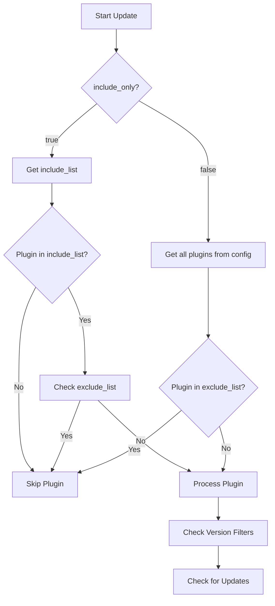
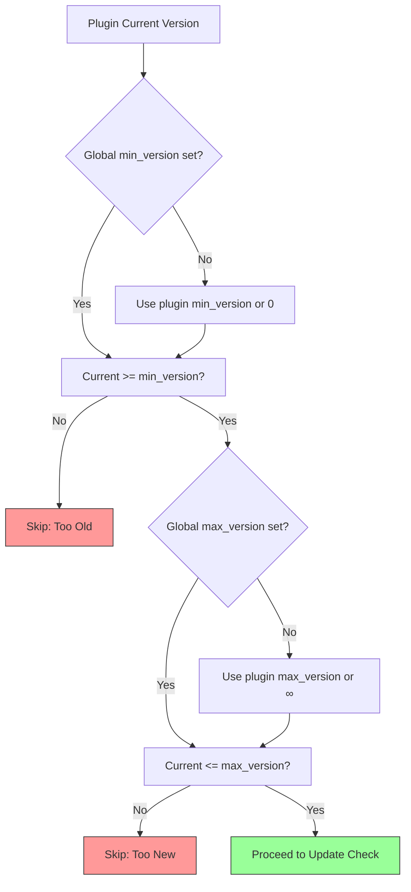
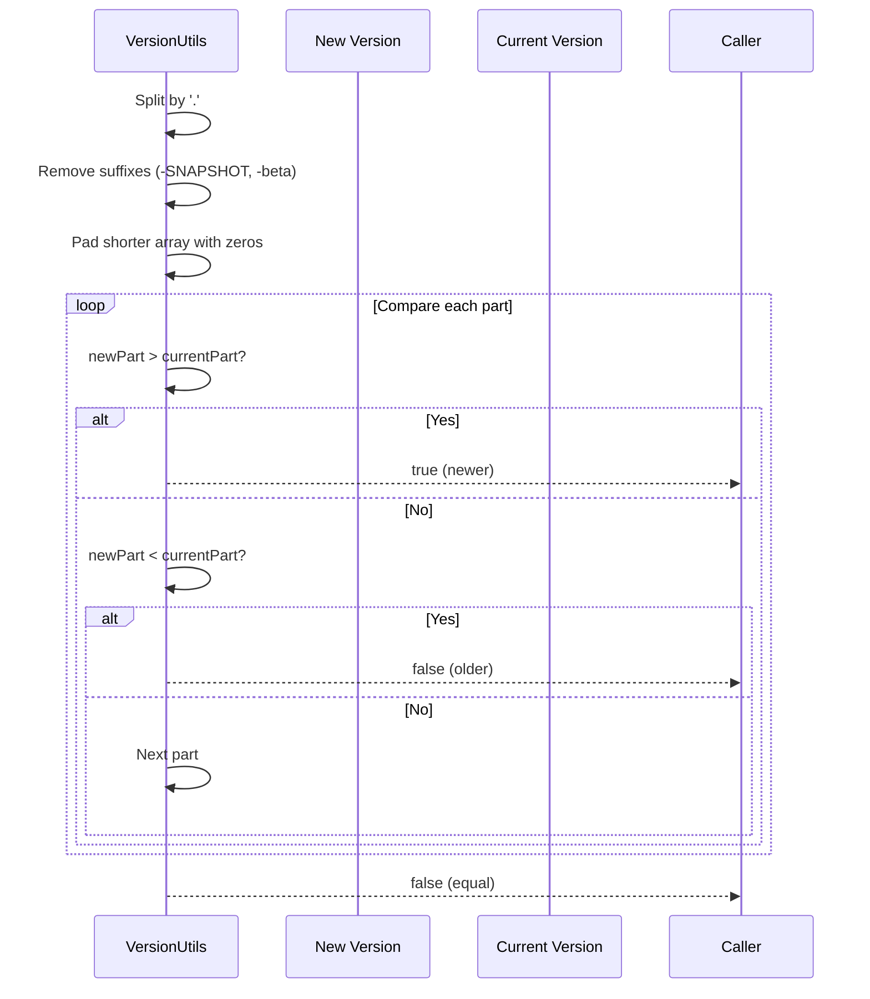

# Configuration Reference

## File Locations

- **Active config**: `plugins/HanafubukiPluginUpdater/config.yml`
- **Example config**: `config.example.yml` (in plugin jar, copied on first run)
- **Plugin data folder**: `plugins/HanafubukiPluginUpdater/`

## Complete Configuration Schema

```yaml
# ============================================
# GLOBAL SETTINGS
# ============================================
global:
  # Minimum version that plugins must meet to be updated
  # Plugins below this version will be skipped
  min_version: "1.0.0"
  
  # Maximum version that plugins can be updated to
  # Use "latest" or high version like "99.99.99" for no limit
  max_version: "99.99.99"

# ============================================
# UPDATE MODES
# ============================================
modes:
  # Include-only mode:
  # - true  = Only update plugins explicitly listed in include_list
  # - false = Update all configured plugins except those in exclude_list
  include_only: false
  
  # List of plugins to exclude from updates
  # Works in BOTH modes (include_only true or false)
  exclude_list:
    - "plugin-to-skip"
    - "another-plugin"
  
  # List of plugins to include (only used when include_only: true)
  include_list:
    - "plugin-to-update"
    - "another-plugin"

# ============================================
# MODRINTH SETTINGS
# ============================================
modrinth:
  # Custom User-Agent (optional, defaults to plugin name/version)
  # user_agent: "MyServer/Updater/1.0"
  
  # Request timeout in seconds (default: 10)
  # timeout: 10
  
  # Default loader filter (default: ["paper"])
  # loaders: ["paper", "spigot"]
  
  # Default game version filter (default: ["1.21.9"])
  # game_versions: ["1.21.9", "1.21.8"]

# ============================================
# GITHUB SETTINGS
# ============================================
github:
  # Custom User-Agent (optional, defaults to plugin name/version)
  # user_agent: "MyServer/Updater/1.0"
  
  # Request timeout in seconds (default: 10)
  # timeout: 10
  
  # GitHub token for authenticated requests (optional, increases rate limit)
  # token: "ghp_xxxxxxxxxxxx"
  
  # Default branch to check if no releases exist (default: "main")
  # default_branch: "main"

# ============================================
# CONSOLE OUTPUT SETTINGS
# ============================================
console:
  # Enable MiniMessage formatting (default: true)
  # Requires Paper/Adventure API
  mini_message: true
  
  # Color configuration for different message types
  colors:
    info: "green"
    warning: "yellow"
    error: "red"
    success: "aqua"
    header: "gold"

# ============================================
# PLUGIN LIST
# ============================================
plugins:
  # Each plugin entry requires:
  # - source: "modrinth" or "github"
  # - version: current installed version (for comparison)
  
  # --- Modrinth plugin example ---
  "worldedit":
    source: "modrinth"
    version: "7.3.12"
    # Optional: explicit Modrinth project ID/slug (auto-detected from name if omitted)
    # project_id: "A1B2C3D4"
    # Optional: override global version filters for this plugin
    # min_version: "7.0.0"
    # max_version: "7.9.9"
  
  # --- GitHub plugin example ---
  "Paper":
    source: "github"
    version: "1.21.9-R0.1"
    # Required for GitHub: owner/repo format
    repo: "PaperMC/Paper"
    # Optional: specific asset name pattern (default: first asset)
    # asset_pattern: "paper-*.jar"
    # Optional: override global version filters
    # min_version: "1.21.0"
    # max_version: "1.21.9"

  # --- Another Modrinth example ---
  "LuckPerms":
    source: "modrinth"
    version: "5.4.120"
    # project_id: "luckperms"
  
  # --- Another GitHub example ---
  "ViaVersion":
    source: "github"
    version: "5.3.0"
    repo: "ViaVersion/ViaVersion"
```

## Configuration Field Reference

### Global Fields

| Field | Type | Required | Default | Description |
|-------|------|----------|---------|-------------|
| `global.min_version` | string | No | `"1.0.0"` | Minimum version threshold |
| `global.max_version` | string | No | `"99.99.99"` | Maximum version threshold |

### Mode Fields

| Field | Type | Required | Default | Description |
|-------|------|----------|---------|-------------|
| `modes.include_only` | boolean | No | `false` | Enable include-only mode |
| `modes.exclude_list` | list<string> | No | `[]` | Plugins to exclude (both modes) |
| `modes.include_list` | list<string> | No | `[]` | Plugins to include (include-only mode) |

### Modrinth Fields

| Field | Type | Required | Default | Description |
|-------|------|----------|---------|-------------|
| `modrinth.user_agent` | string | No | Auto | Custom User-Agent header |
| `modrinth.timeout` | integer | No | `10` | Request timeout seconds |
| `modrinth.loaders` | list<string> | No | `["paper"]` | Loader filters |
| `modrinth.game_versions` | list<string> | No | `["1.21.9"]` | Game version filters |

### GitHub Fields

| Field | Type | Required | Default | Description |
|-------|------|----------|---------|-------------|
| `github.user_agent` | string | No | Auto | Custom User-Agent header |
| `github.timeout` | integer | No | `10` | Request timeout seconds |
| `github.token` | string | No | None | GitHub PAT for auth |
| `github.default_branch` | string | No | `"main"` | Fallback branch |

### Console Fields

| Field | Type | Required | Default | Description |
|-------|------|----------|---------|-------------|
| `console.mini_message` | boolean | No | `true` | Enable MiniMessage |
| `console.colors.*` | string | No | Various | Message colors |

### Plugin Entry Fields

| Field | Type | Required | Default | Description |
|-------|------|----------|---------|-------------|
| `source` | string | Yes | - | `"modrinth"` or `"github"` |
| `version` | string | Yes | - | Current installed version |
| `project_id` | string | Modrinth* | Auto | Modrinth project ID/slug |
| `repo` | string | GitHub* | - | GitHub owner/repo |
| `asset_pattern` | string | GitHub | First asset | Asset filename pattern |
| `min_version` | string | No | Global | Per-plugin min version |
| `max_version` | No | Global | Per-plugin max version |

*Required for respective source type

## Mode Behavior Examples

### Mode Selection Flow



### Mode 1: Include-Only (include_only: true)

```yaml
modes:
  include_only: true
  include_list:
    - "WorldEdit"
    - "LuckPerms"
  exclude_list:
    - "ViaVersion"  # Still works as extra filter
```

Result: Only WorldEdit and LuckPerms checked for updates. ViaVersion ignored even if in plugins list.

### Mode 2: Exclude-Only (include_only: false, default)

```yaml
modes:
  include_only: false
  exclude_list:
    - "ViaVersion"
    - "Geyser"
```

Result: ALL plugins in `plugins:` section checked EXCEPT ViaVersion and Geyser.

## Version Filtering

Global version filters apply to ALL plugins unless overridden per-plugin.

```yaml
global:
  min_version: "5.0.0"   # Skip plugins older than 5.0.0
  max_version: "6.0.0"   # Don't update past 6.0.0 (exclusive)
```

Per-plugin override:
```yaml
plugins:
  "SpecialPlugin":
    source: "modrinth"
    version: "4.5.0"
    min_version: "4.0.0"  # This plugin allowed older versions
    max_version: "5.0.0"  # But capped at 5.0.0
```

### Version Filter Logic



### Version Comparison Algorithm



## MiniMessage Styling

When `console.mini_message: true`, use MiniMessage format in config:

```yaml
console:
  colors:
    info: "<green>"
    warning: "<yellow><bold>"
    error: "<red><italic>"
    success: "<aqua><bold>"
    header: "<gradient:gold:yellow>"
```

See [MiniMessage docs](https://docs.advntr.dev/minimessage/format.html) for syntax.

## Reloading Configuration

Configuration is loaded once on plugin enable. To reload:

1. Edit `config.yml`
2. Run `/updateplugins` (triggers config reload in current implementation)
3. Or restart server

Note: Hot-reload not yet implemented; restart recommended after config changes.