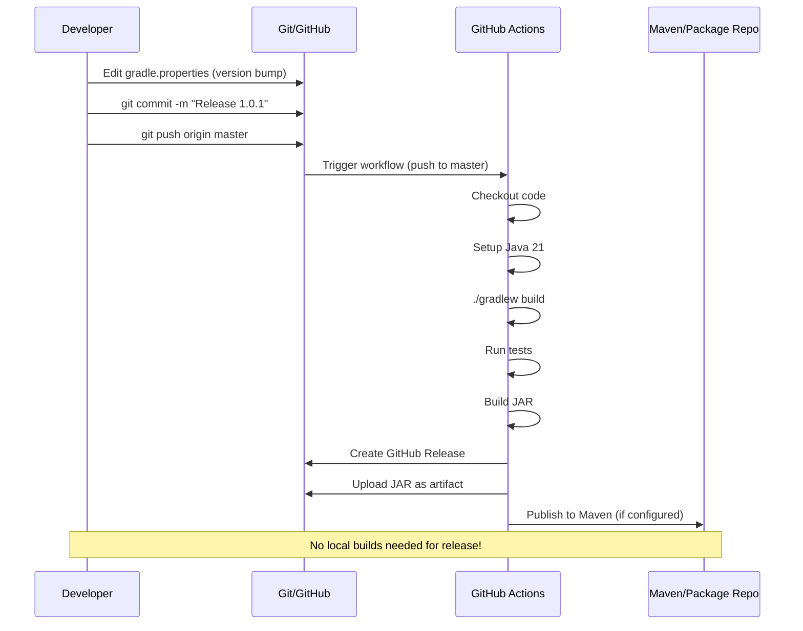

# Development Guide

## Prerequisites

- Java 21 (JDK)
- Gradle 8.x (wrapper included)
- Git

## Project Structure

```
hanafubuki-plugin-updater/
├── build.gradle.kts          # Gradle build script (Kotlin DSL)
├── settings.gradle.kts       # Gradle settings
├── gradle.properties         # Version number
├── gradlew                   # Gradle wrapper (Linux/Mac)
├── gradlew.bat               # Gradle wrapper (Windows)
├── src/
│   ├── main/
│   │   ├── java/com/hanafubuki/updater/
│   │   │   ├── PluginUpdater.java           # Main plugin class
│   │   │   ├── config/ConfigManager.java    # Configuration management
│   │   │   ├── manager/RepositoryManager.java # Update coordination
│   │   │   ├── source/
│   │   │   │   ├── ModrinthSourceHandler.java
│   │   │   │   └── GitHubSourceHandler.java
│   │   │   └── util/VersionUtils.java       # Version comparison
│   │   └── resources/
│   │       └── plugin.yml                   # Plugin descriptor
│   └── test/                                # Unit tests (optional)
├── docs/                                    # Documentation
│   ├── architecture.md
│   ├── configuration.md
│   ├── api.md
│   └── development.md
├── LICENSE                                  # GPLv3
└── README.md
```

## Build Process


### Build Commands

```bash
# Clean build
./gradlew clean build

# Compile only
./gradlew compileJava

# Build JAR only
./gradlew jar

# Run tests
./gradlew test

# Check for dependency updates
./gradlew dependencyUpdates
```

### Version Management

Version lives in **single location**: `gradle.properties`

```properties
version=1.0.0
```

This is automatically expanded into:
- `plugin.yml` → `version: ${version}`
- `MANIFEST.MF` → `Implementation-Version`
- User-Agent headers → `HanafubukiPluginUpdater/1.0.0`

**To bump version:**
1. Edit `gradle.properties`
2. Commit and push
3. GitHub Actions builds and releases automatically

## Release Workflow



### GitHub Actions Workflow (`.github/workflows/release.yml`)

```yaml
name: Release
on:
  push:
    branches: [master]
jobs:
  build:
    runs-on: ubuntu-latest
    steps:
      - uses: actions/checkout@v4
      - uses: actions/setup-java@v4
        with:
          java-version: 21
          distribution: temurin
      - run: ./gradlew build
      - uses: softprops/action-gh-release@v1
        with:
          files: build/libs/*.jar
```

## Testing

### Unit Tests

```bash
./gradlew test
```

Test structure (when implemented):
```
src/test/java/com/hanafubuki/updater/
├── util/VersionUtilsTest.java
├── config/ConfigManagerTest.java
└── source/
    ├── ModrinthSourceHandlerTest.java
    └── GitHubSourceHandlerTest.java
```

### Manual Testing

1. **Local server test:**
   ```bash
   # Build
   ./gradlew build
   
   # Copy to test server
   cp build/libs/hanafubuki-plugin-updater-*.jar /path/to/server/plugins/
   
   # Start server (Paper 1.21.9)
   java -jar paper-1.21.9.jar
   ```

2. **Test commands:**
   - `/updateplugins` - Run update check
   - Check console for MiniMessage output
   - Verify `plugins/update/` folder gets JARs

3. **Config test:**
   - Edit `plugins/HanafubukiPluginUpdater/config.yml`
   - Add test plugins from Modrinth/GitHub
   - Run `/updateplugins` again

## Code Style & Patterns

### Java Conventions

- Package: `com.hanafubuki.updater.*`
- Classes: PascalCase (`PluginUpdater`, `ConfigManager`)
- Methods: camelCase (`getLatestVersion`, `isVersionNewer`)
- Constants: UPPER_SNAKE_CASE (`DEFAULT_TIMEOUT`)
- No wildcard imports

### Async Pattern

All network I/O uses `CompletableFuture`:

```java
// Correct - async
CompletableFuture.runAsync(() -> {
    try {
        performNetworkOperation();
    } catch (Exception e) {
        logger.severe("Error: " + e.getMessage());
    }
});

// Wrong - blocks main thread
performNetworkOperation(); // DON'T DO THIS
```

### Error Handling Pattern

```java
try {
    String result = apiCall();
    if (result != null) {
        processResult(result);
    }
} catch (IOException e) {
    getLogger().warning("API call failed: " + e.getMessage());
    // Continue with other plugins
}
```

### Configuration Access

```java
// Use ConfigManager accessors, not raw maps
boolean includeOnly = configManager.getIncludeOnlyMode();
List<String> excluded = configManager.getExcludeList();
Map<String, Object> plugin = configManager.getPluginDetails(name);
```

## Debugging

### Enable Debug Logging

In `config.yml`:
```yaml
console:
  level: "DEBUG"
```

### Common Issues

| Issue | Cause | Fix |
|-------|-------|-----|
| "Failed to load configuration" | Invalid YAML | Check `config.yml` syntax |
| "Could not find project ID" | Plugin not on Modrinth | Verify plugin name/spelling |
| 403 from API | Missing User-Agent | Check handler sets User-Agent |
| Rate limited | Too many requests | Add GitHub token, cache IDs |
| JAR not in update folder | Download failed | Check network, URL validity |

### Remote Debugging

```bash
# Start server with debug port
java -agentlib:jdwp=transport=dt_socket,server=y,suspend=n,address=*:5005 -jar paper-1.21.9.jar

# Attach IDE debugger to port 5005
```

## Adding Features

### New Source Handler

1. Create `NewSourceHandler.java` in `source/`
2. Implement required methods
3. Register in `RepositoryManager` constructor
4. Add routing in `PluginUpdater.updateSinglePlugin()`
5. Add config section in `ConfigManager`

### New Config Option

1. Add field to `config.yml` schema
2. Add getter in `ConfigManager`
3. Use in relevant component
4. Document in `configuration.md`

### New Command

1. Add to `plugin.yml` commands section
2. Handle in `PluginUpdater.onCommand()`
3. Add permission node
4. Implement async execution

## Dependencies

| Dependency | Version | Purpose |
|------------|---------|---------|
| Paper API | 1.21.9-R0.1-SNAPSHOT | Bukkit/Spigot API |
| Gson | 2.10+ (transitive) | JSON parsing |
| Java HTTP Client | JDK 21 built-in | Network requests |

## IDE Setup

### IntelliJ IDEA
1. Open as Gradle project
2. Enable annotation processing
3. Set Project SDK: Java 21
4. Set Language Level: 21

### VS Code
1. Install Extension Pack for Java
2. Open folder
3. Run `./gradlew build` once
4. Java extension auto-configures

## Contributing

1. Fork repository
2. Create feature branch: `git checkout -b feature/amazing-feature`
3. Make changes
4. Run tests: `./gradlew test`
5. Build: `./gradlew build`
6. Commit: `git commit -m "Add amazing feature"`
7. Push: `git push origin feature/amazing-feature`
8. Open Pull Request

### Commit Message Format

```
type(scope): description

[optional body]

[optional footer]
```

Types: `feat`, `fix`, `docs`, `style`, `refactor`, `test`, `chore`

Example:
```
feat(modrinth): add support for beta versions

Allow configuring include_beta in modrinth section
to include beta/alpha releases in version checks.

Closes #123
```

## Troubleshooting Build

### Gradle Wrapper Issues

```bash
# Regenerate wrapper
gradle wrapper --gradle-version 8.5

# Or download fresh
./gradlew --version
```

### Dependency Resolution

```bash
# Refresh dependencies
./gradlew --refresh-dependencies build

# View dependency tree
./gradlew dependencies
```

### Clean Build

```bash
./gradlew clean build --rerun-tasks
```

## Useful Links

- [Paper API Javadocs](https://jd.papermc.io/paper/1.21.9/)
- [Modrinth API Docs](https://docs.modrinth.com/)
- [GitHub REST API Docs](https://docs.github.com/en/rest)
- [MiniMessage Format](https://docs.advntr.dev/minimessage/format.html)
- [Gradle Kotlin DSL](https://docs.gradle.org/current/userguide/kotlin_dsl.html)