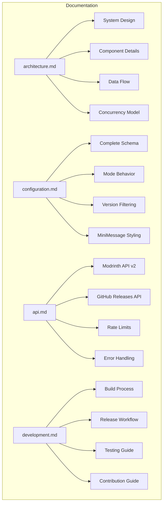

# Documentation Index

Welcome to the Hanafubuki Plugin Updater documentation. This index provides an overview of all available documentation.

## Documentation Files

| File | Description | Audience |
|------|-------------|----------|
| [architecture.md](architecture.md) | System architecture, component design, data flow diagrams | Developers, Contributors |
| [configuration.md](configuration.md) | Complete configuration reference with examples | Server Admins, Developers |
| [api.md](api.md) | Modrinth & GitHub API integration details | Developers, Contributors |
| [development.md](development.md) | Build, test, release workflow, contribution guide | Developers, Contributors |
| [config.example.yml](config.example.yml) | Ready-to-use configuration template | Server Admins |

## Quick Start

1. **Server Admins**: Start with [configuration.md](configuration.md) and copy [config.example.yml](config.example.yml) to `plugins/HanafubukiPluginUpdater/config.yml`
2. **Developers**: Read [architecture.md](architecture.md) first, then [development.md](development.md)
3. **API Integration**: See [api.md](api.md) for Modrinth/GitHub API details

## Architecture Overview



## Configuration Quick Reference

```yaml
# Minimal working config
global:
  min_version: "1.0.0"
  max_version: "99.99.99"

modes:
  include_only: false
  exclude_list: []

plugins:
  "WorldEdit":
    source: "modrinth"
    version: "7.3.12"
  
  "Paper":
    source: "github"
    version: "1.21.9-R0.1"
    repo: "PaperMC/Paper"
```

## Command Usage

```bash
# In-game command (requires op permission)
/updateplugins

# Console command
updateplugins
```

## Version Compatibility

| Component | Version |
|-----------|---------|
| Minecraft | 1.21.9 |
| Paper | 1.21.9-R0.1-SNAPSHOT |
| Java | 21 |
| Modrinth API | v2 |
| GitHub API | v3 (REST) |

## Links

- **GitHub Repository**: https://github.com/Hanafubuki-minecraft/hanafubuki-plugin-updater
- **Releases**: https://github.com/Hanafubuki-minecraft/hanafubuki-plugin-updater/releases
- **Issues**: https://github.com/Hanafubuki-minecraft/hanafubuki-plugin-updater/issues
- **Modrinth API Docs**: https://docs.modrinth.com
- **GitHub API Docs**: https://docs.github.com/en/rest
- **MiniMessage Format**: https://docs.advntr.dev/minimessage/format.html

## License

GPLv3 - See [LICENSE](../LICENSE) for details.